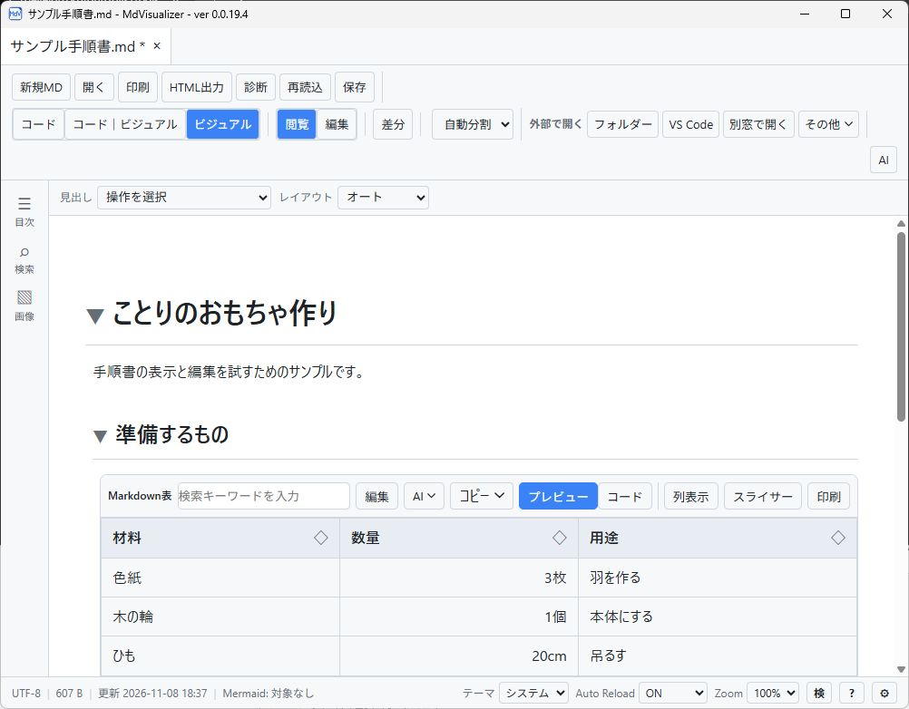
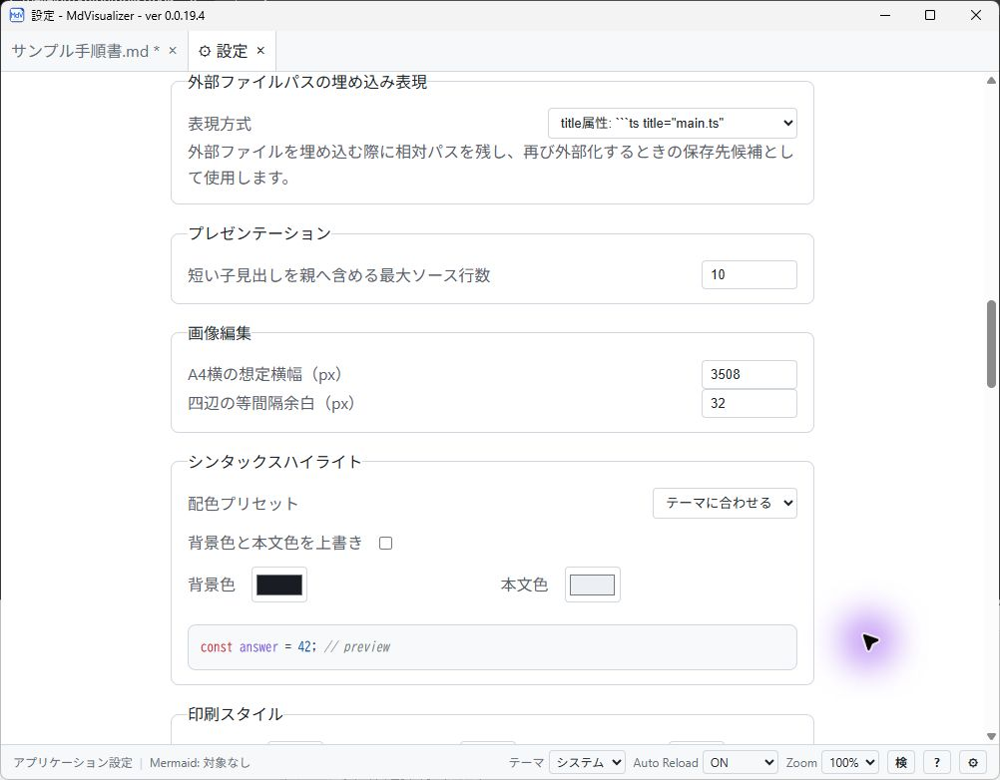
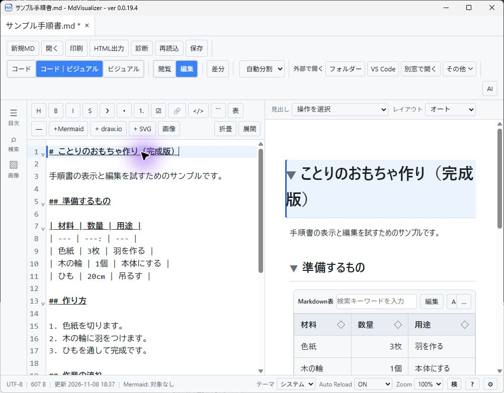
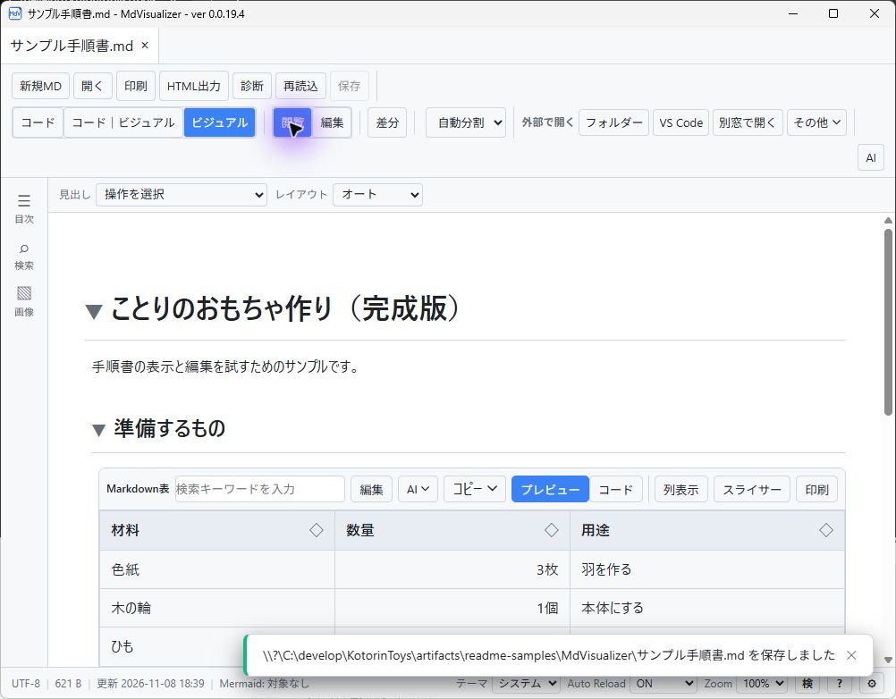
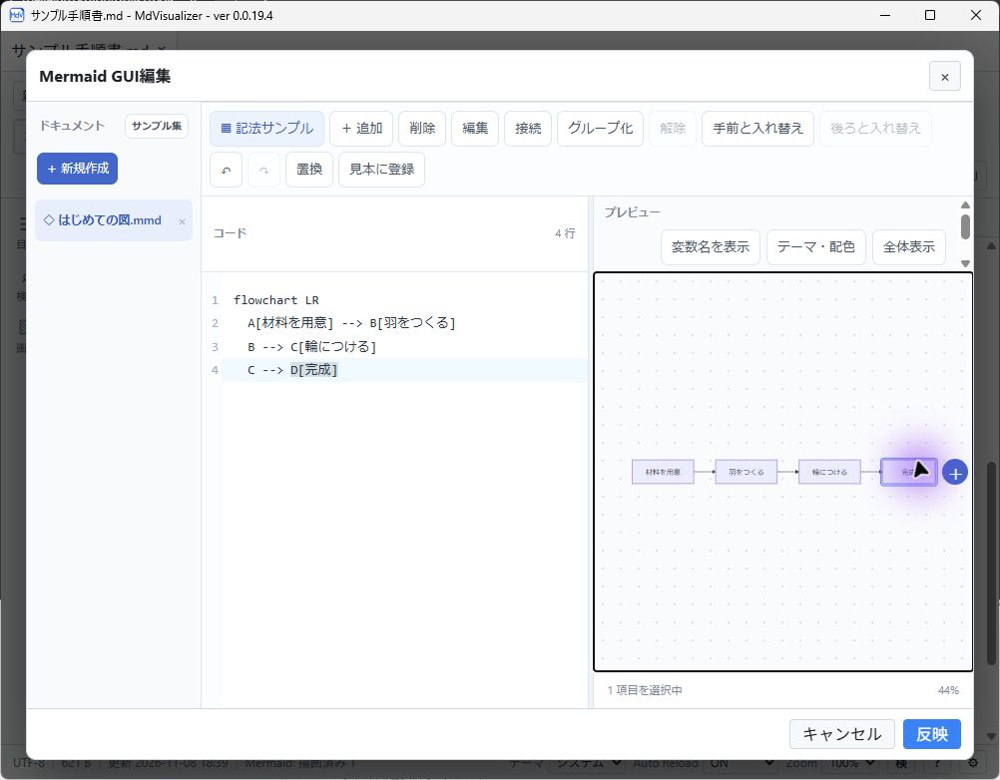

# MdVisualizer

**Markdownの文章・図・表をまとめて読み、編集できます。**

MdVisualizerは、Markdownと図・表を視覚的に扱うビューアー／エディターです。技術メモ、設計書、手順書などのソースを、表示結果と見比べながら扱うために開発しています。一つのアプリで文書を読み、必要な箇所を直し、図や表を確認して、印刷で共有できます。

## 何に使えるか

- **文書を読む・編集する** — 複数の文書をタブで開き、閲覧・編集・ライブプレビューを切り替えます。検索や目次で長い文書も移動できます。
- **図と表を扱う** — Mermaid、draw.io、画像、CSV／TSV表をMarkdownと一緒に表示し、内容を確認・編集できます。
- **変更を確かめて保存する** — 外部更新との差分を確認し、未保存の編集を保護しながら保存します。
- **説明や共有に使う** — 印刷・PDF出力や、見出しから構成するプレゼン表示を利用できます。
- **AIに相談する** — 任意導入のCodex CLIを使い、文章・画像・図について相談し、提案を確認して取り込めます。

## アプリケーションの種類

デスクトップアプリ版とSharePoint Framework（SPFx）版を提供し、Webブラウザー版を準備しています。

### デスクトップアプリ版 — Windowsのファイルをダブルクリックして編集

**Markdown（.md）、draw.io（.drawio）、Mermaid（.mmd）、SVG（.svg）を関連付け、エクスプローラーからダブルクリックで開いて、そのままGUIで編集できるツールです。** 文章だけでなく、図も画面上で確認・編集できます。

ローカルファイルに加え、**SharePoint Onlineのドキュメントライブラリへ接続し、文書を直接開いて編集・保存することもできます。** デスクトップからの接続にはSPFx版の配置を必要としません。

### SPFx版 — SharePoint Onlineの社内領域で編集

**SharePoint Online内に配置し、社内のアクセス権で保護された領域で、ブラウザーから文書を閲覧・編集するアプリです。** ドキュメントライブラリの文書を、組織の認証と権限のもとで扱えます。利用者ごとのデスクトップアプリのインストールを必要とせず、社内の文書活用に使えます。

### Webブラウザー版 — 誰でも使える文書編集サービス（準備中）

一般的なWebサイトに配置し、誰でもブラウザーから利用できるサービスを予定しています。**サービス側には文書データを保存せず、利用者が投入したデータファイルや、サインインしたGoogle Drive・OneDrive内のMarkdownファイルを編集する構想です。**

この版は現在準備中です。ファイルの取り込み、クラウドへのサインイン、編集・保存の提供は今後の予定です。

## デスクトップ版を使い始める

1. [配布ページ](https://excel-chunchun.sakura.ne.jp/download/MdVisualizer.html)でbeta版を取得します。
2. [インストール手順](docs/user/INSTALLATION.md)に従って導入します。
3. Markdownファイルを開き、読むだけなら閲覧モード、編集するなら「編集／閲覧」を選びます。変更は保存ボタンまたはCtrl+Sで保存します。

操作方法、対応記法、ショートカット、SharePoint連携の条件は[利用ガイド](docs/USERS_GUIDE.md)にまとめています。まず表示を試す場合は[samples](samples/)の文書を利用できます。

## 画面で見る基本操作

画像の撮影にはWindowsデスクトップ版0.0.19.4と、説明用の文書、専用設定を使いました。

### 1. 文書を開く

「開く」からMarkdownを選びます。「ビジュアル」では見出し・表・図を読みやすい形で表示します。

### 2. 表示・出力の設定を確認する

右下の歯車から設定を開きます。画像出力サイズ、印刷、コードの配色などを調整できます。変更したら、設定画面で保存してください。

### 3. 内容を編集する

「コード｜ビジュアル」と「編集」を選ぶと、Markdownと表示結果を並べて確認できます。例では見出しに「（完成版）」を追記しています。

### 4. 保存して結果を確認する

「保存」またはCtrl+Sを押します。「ビジュアル」「閲覧」に戻すと、編集結果を読む画面に切り替わります。タブの未保存マークが消えたことを確認してください。

### 5. Mermaidの図を編集する

Mermaidブロックの「編集」からGUI編集を開きます。図の項目を選んで編集や接続などを行い、「反映」で変更を文書に戻します。その後、文書も保存します。変更しない場合は「キャンセル」で閉じられます。

## 開発・ビルドする

デスクトップ版はReact／TypeScriptとRust／Tauri、SPFx版はSharePoint Frameworkで構成しています。両者はMarkdown処理を共有します。自分でビルドしたり、機能を変更したりする場合は次の資料から始めてください。

- [開発者ガイド](docs/DEVELOPERS_GUIDE.md)：構成、実装境界、設計・検証資料への入口
- [開発環境のセットアップ](docs/developer/DEVELOPMENT_SETUP.md)：必要な環境、初回起動、パッケージ作成
- [ビルド・検証コマンド](docs/developer/BUILD_COMMANDS.md)：依存導入、ビルド、テストの実行方法

## 詳しい使い方

- [利用ガイド](docs/USERS_GUIDE.md)
- [AI相談・編集](docs/user/ui/codex.md)／[AIスキル設定](docs/user/ui/codex-skills.md)
- [HTML出力CLI](docs/user/HTML_EXPORT_CLI.md)：文書を単独のHTMLファイルへ出力するツール

## ライセンス

MIT License。
