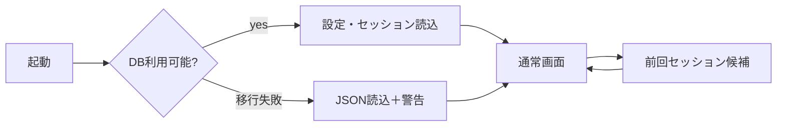

# DES-02 補助SQLiteデータストア設計

作成日: 2026-08-30
状態: PROPOSED
対象版: v0.0.14

## 背景

現在は設定と折りたたみ状態をJSONへ保存し、排他ロック、再読込マージ、原子的置換、破損退避を実装している。これは少量設定には適するが、セッション、最近使った項目、将来の同期キュー、AI実行メタデータ、schema migrationには不向きである。

## 目的

- Markdown本文を正本のまま維持し、補助状態だけをSQLiteへ保存する。
- schema migration、トランザクション、同時更新、破損検知を一元化する。
- テストごとに空の一時DBを自動生成する。
- 既存JSONから安全に一回移行し、失敗時はJSON利用へ戻せるようにする。

## 機能概要

v0.0.14では設定、最近使った文書、ウィンドウ／タブセッションを対象とする。Markdown本文、未保存ドラフト、AIへ送信した本文、SharePoint本文、検索全文索引は保存しない。同期キューとAI履歴のtableは後続migrationで追加する。

## ユースケース

### UC-D01 設定を保存する

テーマ変更などをkey単位でupsertし、複数ウィンドウの別キー変更を失わない。

### UC-D02 前回セッションを提示する

正常終了時のタブパスと表示状態を保存する。ただし起動引数で文書が指定された場合は自動復元せず、明示操作の候補として扱う。

### UC-D03 旧JSONを移行する

初回DB作成時に設定と折りたたみ状態をtransactionで移行し、成功後も旧JSONを日時付きバックアップとして残す。

## 画面遷移



DB破損や移行失敗は起動を妨げず、設定画面に回復通知とバックアップ場所を表示する。

## 処理フロー

1. アプリデータ領域の`state/markdownviewer.db`を開く。
2. WAL、foreign keys、busy timeoutを設定する。
3. `schema_migrations`を確認し、未適用migrationをtransactionで実行する。
4. DBが新規で旧JSONが存在する場合だけ移行する。
5. 読込結果をtyped DTOとして返す。
6. shutdownまたはdebounceでセッション概要を保存する。

## データ構造

```sql
CREATE TABLE schema_migrations (
  version INTEGER PRIMARY KEY,
  applied_at TEXT NOT NULL
);

CREATE TABLE settings (
  key TEXT PRIMARY KEY,
  value_json TEXT NOT NULL,
  updated_at TEXT NOT NULL
);

CREATE TABLE recent_documents (
  source_key TEXT PRIMARY KEY,
  source_kind TEXT NOT NULL CHECK(source_kind IN ('local','sharepoint')),
  display_name TEXT NOT NULL,
  last_opened_at TEXT NOT NULL,
  pinned INTEGER NOT NULL DEFAULT 0
);

CREATE TABLE sessions (
  id TEXT PRIMARY KEY,
  window_label TEXT NOT NULL,
  saved_at TEXT NOT NULL,
  closed_cleanly INTEGER NOT NULL
);

CREATE TABLE session_tabs (
  session_id TEXT NOT NULL REFERENCES sessions(id) ON DELETE CASCADE,
  position INTEGER NOT NULL,
  source_key TEXT NOT NULL,
  active INTEGER NOT NULL,
  ui_state_json TEXT NOT NULL,
  PRIMARY KEY(session_id, position)
);
```

`ui_state_json`に保存してよいのは表示モード、スクロール、ズーム、検索パネル種別などであり、検索語、本文、選択文字列、AI promptは保存しない。

## API設計

### Rust

```rust
pub trait AppStateRepository {
    fn load_profile(&self) -> Result<AppProfile, StateStoreError>;
    fn update_settings(&self, updates: serde_json::Value) -> Result<serde_json::Value, StateStoreError>;
    fn save_session(&self, session: SessionSummary) -> Result<(), StateStoreError>;
    fn list_recent(&self, limit: u32) -> Result<Vec<RecentDocument>, StateStoreError>;
}
```

### Tauri DTO

```ts
export interface SessionSummary {
  id: string;
  windowLabel: string;
  closedCleanly: boolean;
  tabs: Array<{ sourceKey: string; position: number; active: boolean; uiState: TabUiState }>;
}
```

入力例:

```json
{"key":"theme","value":"dark"}
```

出力例:

```json
{"theme":"dark","zoom":100,"viewMode":"auto"}
```

### 対象ファイルと作成物

| 操作 | 対象 |
| --- | --- |
| 新規 | `src-tauri/src/state_store/mod.rs` |
| 新規 | `src-tauri/src/state_store/sqlite.rs`、`migrations.rs`、`models.rs` |
| 新規 | `src-tauri/migrations/0001_initial.sql` |
| 新規 | `src/adapters/tauriAppStateRepository.ts` |
| 変更 | `src-tauri/src/commands/window_settings.rs` |
| 変更 | `src-tauri/src/settings.rs`（移行readerとして維持） |
| 変更 | `src/hooks/useApplicationSettings.ts` |

### 作成する関数

| 関数 | 引数 | 戻り値 |
| --- | --- | --- |
| `open_state_database` | `app_data_dir: &Path` | `Result<Connection, StateStoreError>` |
| `apply_migrations` | `&mut Connection` | `Result<u32, StateStoreError>` |
| `migrate_legacy_json` | `&mut Connection, LegacyPaths` | `Result<MigrationReport, StateStoreError>` |
| `new_test_database` | なし | `TestStateStore` |

## エラーハンドリング

- locked: busy timeout後に再試行可能として返す。
- corrupt: DBを日時付き隔離し、新規DBを作る。隔離失敗時は書込みを無効化して起動する。
- migration failed: transaction rollbackし、旧JSON readerで起動する。
- disk full: 現在設定をメモリに保持し、永続化失敗を通知する。
- incompatible future schema: DBを書き換えず、対応版への更新を案内する。

## テスト方針

- Unit: 各migration、DTO、保存禁止フィールド検査。
- Integration: `tempfile`内SQLiteをケースごとに作り、並行更新、rollback、破損、disk errorを模擬する。
- Migration: 実在するv0.0.1〜v0.0.13の設定fixtureを移行する。
- Security: DBにMarkdown本文、APIキー、refresh token、検索語が保存されないことを走査する。
- Performance: 設定読込p95 50ms以下、100タブセッション保存p95 100ms以下。

## Definition of Ready

- 保存を許可するデータ分類表がレビュー済みである。
- 旧JSON fixtureが匿名化されている。
- `rusqlite`採用時のライセンス・ビルド方式が確認済みである。

## 完了条件 / Definition of Done

- 新規インストール、旧JSON移行、DB破損回復が自動テストで成功する。
- Markdown本文と秘密情報がDBへ保存されない。
- 既存設定UIと折りたたみ状態が退行しない。
- DB migrationは再実行しても冪等である。
- DBを削除しても文書本体が失われず、既定状態で起動できる。

## 将来拡張案

- v0.0.15で`sync_jobs`、`sync_documents`、v0.0.16で本文を含まない`ai_runs`を追加する。
- 明示的な企業要件がある場合だけ、暗号化されたクラッシュ復旧ドラフトを別設計で追加する。
- 検索全文索引はデータ複製と機密性を評価してからopt-inで検討する。
