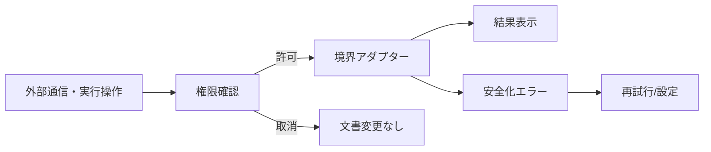

# DES-03 セキュリティ境界設計

本書は継続利用する設計資料の正本。対象版・状態・完了条件は策定時の計画を示し、現在の実装済み範囲を保証しない。実装や再開の判断は現在の要求とソースで確認する。

作成日: 2026-08-30
状態: PROPOSED
対象版: v0.0.14

## 背景

現行実装はMarkdown/HTML/SVGサニタイズ、URL制限、ファイル競合保護、Windows資格情報マネージャー、PowerShell確認実行を持つ。一方、Tauri CSPは無効、asset protocolは全域許可であり、同期・AI・CLIを追加する前に境界を縮小する必要がある。

## 目的

- 一般企業利用に適した最小権限と安全な既定値を定義する。
- ファイル、ネットワーク、秘密情報、外部プロセスを別能力として制御する。
- 利用者が外部送信先とファイル変更内容を確認できるようにする。
- セキュリティ回帰をCIで自動検出する。

## 機能概要

1. CSPを有効化し、自己コンテンツ、必要な画像、公式diagrams.net frameだけを許可する。
2. 任意ローカルファイルのasset protocol依存を廃止し、検証済みbackend read＋Blob URLへ移行する。
3. commandごとに能力、パス規則、入力上限、監査対象を定義する。
4. SharePointとAIの送信先allowlistをプロバイダー設定から生成する。
5. SharePoint refresh tokenとAI APIキーを共通`SecretStore`へ分離する。

## ユースケース

### UC-S01 Markdownを安全に表示する

危険HTML、SVG外部参照、JavaScript URLを除去し、CSP違反が起きても文書全体を失わず該当要素を代替表示する。

### UC-S02 外部プロセスを実行する

PowerShellまたはAI CLIの実行前に実行ファイル、対象文書、送信範囲、作業フォルダーを表示し、shellを介さず直接起動する。

### UC-S03 APIキーを保存する

キー本文はReact state、SQLite、ログへ永続化せず、Windows資格情報マネージャーへ保存する。UIへ返すのは登録有無と末尾識別子だけとする。

## 画面遷移



通常のSharePoint同期は初回有効化時に範囲を確認し、以降はステータス表示からいつでも停止できる。新しい送信先や権限拡大時は再確認する。

## 処理フロー

1. UIが`SecurityIntent`を構築する。
2. policy evaluatorが能力、文書区分、送信先、サイズ上限を検査する。
3. 確認が必要ならUIへ説明可能な`SecurityPrompt`を返す。
4. 承認tokenと共に境界処理を呼ぶ。
5. Rustで同じ規則を再検証する。
6. 秘密を注入してHTTP／processを実行し、秘密を除去した結果だけ返す。

## データ構造

```ts
export type SecurityCapability =
  | "read_document" | "write_document" | "read_asset" | "write_asset"
  | "network_sharepoint" | "network_diagrams" | "network_ai"
  | "process_powershell" | "process_ai_cli";

export interface SecurityIntent {
  capability: SecurityCapability;
  sourceKey?: string;
  destinationHost?: string;
  byteLength?: number;
  executablePath?: string;
}

export interface SecurityDecision {
  allowed: boolean;
  requiresConfirmation: boolean;
  reasonCode: string;
  displayDetails: string[];
}
```

## API設計

### CSP初期案

```text
default-src 'self';
script-src 'self';
style-src 'self' 'unsafe-inline';
img-src 'self' blob: data:;
connect-src 'self' ipc: http://ipc.localhost;
frame-src https://embed.diagrams.net;
object-src 'none';
base-uri 'none';
form-action 'none'
```

`unsafe-inline` styleは既存UI互換のため暫定許可し、style属性利用箇所の削減後に再評価する。AI APIとGraph通信はRust側HTTPを通し、WebViewの`connect-src`へ外部ホストを追加しない。

### Rust trait

```rust
pub trait SecretStore {
    fn put(&self, key: &SecretKey, value: &str) -> Result<(), SecretStoreError>;
    fn get(&self, key: &SecretKey) -> Result<Option<SecretValue>, SecretStoreError>;
    fn delete(&self, key: &SecretKey) -> Result<(), SecretStoreError>;
}
```

入力例:

```json
{"capability":"process_ai_cli","sourceKey":"C:/docs/spec.md","executablePath":"C:/tools/codex.exe","byteLength":18432}
```

出力例:

```json
{"allowed":true,"requiresConfirmation":true,"reasonCode":"external_process","displayDetails":["codex.exe","spec.md","18 KB"]}
```

### 対象ファイル

| 操作 | 対象 |
| --- | --- |
| 変更 | `src-tauri/tauri.conf.json`、`src-tauri/capabilities/default.json` |
| 新規 | `packages/application-core/src/security.ts` |
| 新規 | `src/security/securityPolicy.ts`、`src/components/SecurityConsentDialog.tsx` |
| 新規 | `src-tauri/src/security/policy.rs`、`secrets.rs`、`network.rs`、`process.rs` |
| 変更 | `src-tauri/src/credential_store.rs`（汎用化） |
| 変更 | `src/lib/path.ts`、`src/components/ImageRenderer.tsx`（Blob URL移行） |

### 作成する関数

| 関数 | 引数 | 戻り値 |
| --- | --- | --- |
| `evaluateSecurityIntent` | `intent, policy` | `SecurityDecision` |
| `readSafeAsset` | `documentSource, relativePath, maxBytes` | `Promise<SafeAsset>` |
| `runApprovedProcess` | `ApprovedProcessRequest` | `ProcessResult` |
| `redactDiagnostic` | `unknown` | `SafeDiagnostic` |

## エラーハンドリング

- policy_denied: 理由と設定場所を示す。処理は実行しない。
- invalid_path: 正規化後の対象を明かしすぎず、文書配下制限を説明する。
- secret_unavailable: 再登録導線を出し、ログへ秘密を出さない。
- csp_violation: 開発時は収集、releaseでは機密URLを除いた診断IDだけを表示する。
- process_timeout/output_limit: 子プロセスを終了し、部分出力を上限内で返す。
- network_untrusted_host: redirect先も再検証し、許可外へAuthorizationを送らない。

## テスト方針

- Unit: capability表、ホスト、redirect、パス、サイズ、秘密redaction。
- Integration: object URLの解放、資格情報保存、process timeout、出力上限。
- Security: XSS corpus、SVG corpus、CSPテスト、path traversal、symlink/junction、SSRF、prompt injection境界。
- E2E: 危険Markdownを開いてもscript・外部通信・ローカルファイル読出しが発生しない。
- Dependency: `npm audit --omit=dev`、Rust advisory scan、SPFx auditをCIで実行する。

## Definition of Ready

- 現行Tauri commandと外部通信の能力一覧が完成している。
- CSP report-only相当の開発検証で必要hostが確認されている。
- 任意ファイルasset protocolを置き換える性能測定がある。

## 完了条件 / Definition of Done

- release構成でCSPが有効、`assetProtocol.scope=["**"]`が存在しない。
- 全custom commandが責務別validatorを通る。
- 秘密値がDB、ログ、DOM、エラー、テストsnapshotへ含まれない。
- 危険HTML/SVG/path/network/processの回帰テストがCIで成功する。
- diagrams.net、SharePoint、外部エディター、PowerShellの既存導線が受入可能である。

## 将来拡張案

- 組織管理ポリシーファイル、Windows Group Policy、署名済み設定を追加する。
- 外部プラグイン採用時は能力manifestとsandboxをこのpolicyへ接続する。
- SPFx AI用の組織管理proxyが決まった場合、同じ送信先・同意モデルを適用する。
