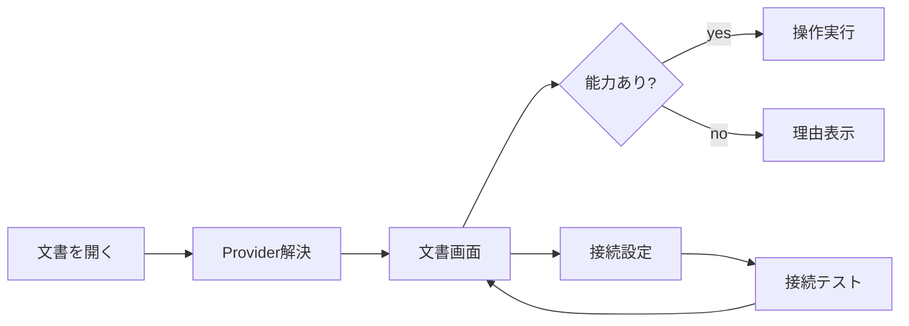

# DES-04 内部プロバイダー基盤設計

本書は継続利用する設計資料の正本。対象版・状態・完了条件は策定時の計画を示し、現在の実装済み範囲を保証しない。実装や再開の判断は現在の要求とソースで確認する。

作成日: 2026-08-30
状態: PROPOSED
対象版: v0.0.14

## 背景

デスクトップはTauri command、SPFxはSharePoint RESTを直接利用し、将来の同期・AIも別経路になる。外部プラグインは採用しないが、本体内部で実装差を交換できなければ、両製品の仕様差とテスト重複が増える。

## 目的

- ストレージ、同期、AIを共通の内部interfaceとして定義する。
- 画面が具体的なTauri command、REST URL、CLI名を知らない構造にする。
- fake providerによりネットワーク・GUIなしで全状態を再現する。
- provider追加を小型モデルが一つのadapter実装として完結できるようにする。

## 機能概要

`packages/application-core`へprovider contract、能力、共通エラーを置く。v0.0.14ではLocal、SharePoint、FakeのDocumentProviderと、未接続のSync/AI provider contractを作る。本番同期・AI接続はv0.0.15以降とする。

## ユースケース

### UC-P01 実行環境に合うproviderを選ぶ

デスクトップのローカル文書は`tauri-local`、`spmd:`は`tauri-sharepoint`、SPFxは`spfx-sharepoint`を選択する。

### UC-P02 能力差をUIへ伝える

providerが`canWrite`、`supportsBackgroundSync`、`supportsCliAi`等を返し、UIは利用不可操作を理由付きで無効化する。

### UC-P03 fakeで障害を再現する

テストが遅延、offline、401、412、429、部分ストリーム、キャンセルを決定的に設定する。

## 画面遷移



## 処理フロー

1. `ProviderRegistry.resolve(source, platform)`でprovider IDを選ぶ。
2. providerの`describeCapabilities()`を取得する。
3. application use caseへproviderを注入する。
4. provider固有エラーを`ProviderFailure`へ変換する。
5. UIは共通結果だけを処理する。

## データ構造

```ts
export type ProviderKind = "document" | "sync" | "ai";

export interface ProviderDescriptor {
  id: string;
  kind: ProviderKind;
  displayName: string;
  capabilities: Record<string, boolean>;
  availability: "available" | "configuration_required" | "unsupported";
  unavailableReason?: string;
}

export interface ProviderFailure {
  providerId: string;
  code: "unauthorized" | "forbidden" | "offline" | "rate_limited" |
        "conflict" | "invalid_response" | "cancelled" | "unexpected";
  retryable: boolean;
  retryAfterMs?: number;
  safeMessage: string;
  diagnosticId?: string;
}
```

## API設計

```ts
export interface ProviderRegistry {
  list(kind?: ProviderKind): readonly ProviderDescriptor[];
  resolveDocument(source: DocumentSource): DocumentRepository;
  getSync(id: string): SyncProvider | undefined;
  getAi(id: string): AiProvider | undefined;
}

export interface SyncProvider {
  inspect(source: DocumentSource, signal?: AbortSignal): Promise<SyncInspection>;
  execute(job: SyncJob, signal?: AbortSignal): Promise<SyncResult>;
}

export interface AiProvider {
  describe(): Promise<AiProviderDescriptor>;
  run(request: AiRequest, sink: AiEventSink, signal?: AbortSignal): Promise<AiResult>;
}
```

入力例:

```json
{"kind":"sharepoint","uri":"spmd://tenant.sharepoint.com/sites/docs/Shared%20Documents/a.md"}
```

出力例:

```json
{"id":"tauri-sharepoint","kind":"document","capabilities":{"canWrite":true,"supportsBackgroundSync":true},"availability":"available"}
```

### 対象ファイル

| 操作 | 対象 |
| --- | --- |
| 新規 | `packages/application-core/src/providers/types.ts`、`registry.ts` |
| 新規 | `packages/application-core/src/providers/fakes.ts` |
| 新規 | `src/providers/desktopProviderRegistry.ts` |
| 新規 | `src/adapters/tauriLocalDocumentProvider.ts`、`tauriSharePointDocumentProvider.ts` |
| 新規 | `spfx/src/webparts/mdVisualizer/adapters/spfxProviderRegistry.ts` |
| 変更 | `spfx/.../SharePointMarkdownRepository.ts`（contract adapter化） |

### 作成するクラス・関数

| 名前 | 引数 | 戻り値 |
| --- | --- | --- |
| `DefaultProviderRegistry` | `ProviderDescriptor[]` | `ProviderRegistry` |
| `resolveProviderId` | `source, platform` | `string` |
| `normalizeProviderFailure` | `providerId, unknown` | `ProviderFailure` |
| `FakeDocumentProvider.enqueue` | `FakeOutcome` | `void` |

サンプル:

```ts
const fake = new FakeDocumentProvider();
fake.enqueue({ type: "conflict", latest: fixtureSnapshot("# remote") });
const result = await saveDocument(fake, dirtySession("# local"));
expect(result.status).toBe("conflict");
```

## エラーハンドリング

- provider固有のHTTP本文、CLI stderr、Rust debug値をUIへ直接渡さない。
- `retryable`と`retryAfterMs`で再試行可能性を表す。
- provider未構成は例外ではなく`configuration_required`として設定導線を返す。
- キャンセルはエラートーストを出さず、状態を開始前へ戻す。
- 能力のない操作はproviderを呼ぶ前に抑止し、理由を表示する。

## テスト方針

- Contract test suiteを一つ作り、全DocumentProviderへ適用する。
- Fake clockとFakeProviderでtimeout、再試行、キャンセルを決定的に検証する。
- デスクトップ／SPFxの同一fixtureに対するsnapshot、error code、encoding保持を比較する。
- registryの重複ID、能力不整合、未登録sourceを異常系で検証する。

## Definition of Ready

- DES-01の`DocumentRepository`と共通エラーが確定している。
- 現行Tauri/SPFx機能の能力マトリクスがある。
- provider contractにUI固有型が含まれていない。

## 完了条件 / Definition of Done

- UIからTauri command／SharePoint RESTの直接呼出しがprovider adapter外にない。
- Local、SharePoint desktop、SharePoint SPFx、Fakeが共通contract testを通る。
- Sync/AIのfake providerで後続画面を開発できる。
- 外部プラグインコード、動的module読込、任意manifest実行は含まない。

## 将来拡張案

- 組織管理AI endpoint、将来のGit adapter、エクスポートproviderを内部実装として追加する。
- 外部プラグインが必要になった場合は署名・権限・互換性を別設計し、このregistryへ直接任意コードを登録しない。
