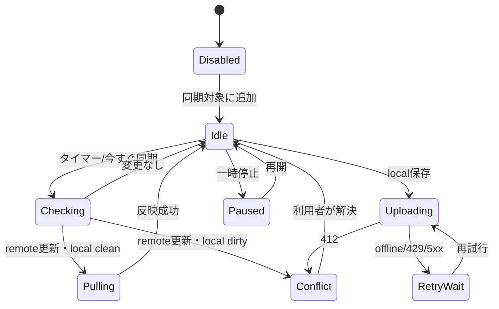

# DES-05 SharePointバックグラウンド同期設計

本書は継続利用する設計資料の正本。対象版・状態・完了条件は策定時の計画を示し、現在の実装済み範囲を保証しない。実装や再開の判断は現在の要求とソースで確認する。

作成日: 2026-08-30
状態: DEFERRED
対象版: v0.0.15

## 背景

デスクトップ版はMicrosoft GraphでSharePoint文書を明示的に読込・保存し、eTag/If-Matchで競合を保護している。ユーザー方針により、次段階ではSharePointとのバックグラウンド同期を提供する。無制限なサイト走査や自動上書きは行わない。

## 目的

- 利用者が明示登録したSharePoint文書の更新をバックグラウンドで検出する。
- 一時的なoffline、429、認証失効から自動回復する。
- 未保存編集や双方向更新を自動上書きせず、Diffで解決する。
- 同期状態をSQLiteへ保存し、再起動後も安全に再開する。

## 機能概要

- 開いたSharePoint文書を「同期対象に追加」できる。
- cleanな文書にremote更新があれば自動取得し、表示を更新する。
- dirtyな文書またはlocal save待ちにremote更新があれば`conflict`へ遷移する。
- 保存成功後のupload失敗はキューへ残し、指数backoffで再試行する。
- 同期は停止、一時停止、今すぐ同期、対象解除ができる。

## ユースケース

### UC-Y01 remote更新を自動反映する

利用者が編集していない同期対象に新しいeTagが見つかった場合、最新版を取得してタブへ反映する。スクロール・表示モードを保持する。

### UC-Y02 offline保存を再送する

ネットワーク断でuploadできない場合、ローカル案と基準eTagを暗号化されていないSQLite本文へ保存しない。文書ドラフトは開いているセッションまたは明示的な復旧ファイルに保持し、同期jobは参照IDだけを保存する。

### UC-Y03 競合を解決する

remoteとlocalの両方が変更された場合、既存Diff画面で比較し、「remote採用」「local案を新eTag基準で再保存」「手動編集」を選ぶ。

## 画面遷移



## 処理フロー

1. schedulerが期限到来jobを最大3件取得する。
2. 認証を更新し、Graph metadataからeTagだけを確認する。
3. 変更なしなら次回時刻を更新する。
4. 変更ありなら現在セッションのdirty/revisionを問い合わせる。
5. cleanならcontentを取得し、revision一致を再確認して反映する。
6. dirtyならremote snapshotを一時メモリへ取得し、conflict状態にする。
7. 429/5xx/offlineは`Retry-After`または指数backoff＋jitterで再試行する。

## データ構造

```sql
CREATE TABLE sync_documents (
  id TEXT PRIMARY KEY,
  source_uri TEXT NOT NULL UNIQUE,
  last_known_etag TEXT NOT NULL,
  state TEXT NOT NULL,
  enabled INTEGER NOT NULL,
  next_check_at TEXT,
  last_success_at TEXT,
  last_error_code TEXT
);

CREATE TABLE sync_jobs (
  id TEXT PRIMARY KEY,
  document_id TEXT NOT NULL REFERENCES sync_documents(id) ON DELETE CASCADE,
  kind TEXT NOT NULL CHECK(kind IN ('check','pull','push')),
  state TEXT NOT NULL,
  attempt INTEGER NOT NULL DEFAULT 0,
  run_after TEXT NOT NULL,
  base_etag TEXT NOT NULL,
  session_reference TEXT
);
```

本文、access token、refresh token、AI promptは保存しない。`source_uri`はSharePointパスを含むため、診断出力では既定で伏せる。

## API設計

```ts
export interface SharePointSyncService {
  register(source: Extract<DocumentSource, { kind: "sharepoint" }>): Promise<SyncDocument>;
  unregister(id: string): Promise<void>;
  pause(id: string, paused: boolean): Promise<void>;
  syncNow(id: string, signal?: AbortSignal): Promise<SyncResult>;
  subscribe(listener: (event: SyncEvent) => void): () => void;
}

export type SyncResult =
  | { status: "unchanged"; checkedAt: string }
  | { status: "pulled"; snapshot: DocumentSnapshot }
  | { status: "queued"; retryAt: string }
  | { status: "conflict"; localRevision: string; remote: DocumentSnapshot };
```

入力例:

```json
{"id":"sync-42","action":"syncNow"}
```

出力例:

```json
{"status":"queued","retryAt":"2026-08-30T12:05:00Z"}
```

### 対象ファイル

| 操作 | 対象 |
| --- | --- |
| 新規 | `packages/application-core/src/sync/model.ts`、`service.ts`、`scheduler.ts` |
| 新規 | `src/features/sync/SyncStatusButton.tsx`、`SyncPanel.tsx`、`useSyncDocument.ts` |
| 新規 | `src/adapters/tauriSharePointSyncProvider.ts` |
| 新規 | `src-tauri/src/sync/mod.rs`、`scheduler.rs`、`repository.rs`、`worker.rs` |
| 変更 | `src-tauri/src/sharepoint.rs`（Graph clientをadapter化） |
| 変更 | SQLite migration `0002_sync.sql` |

### 作成する関数

| 関数 | 引数 | 戻り値 |
| --- | --- | --- |
| `nextBackoff` | `attempt, retryAfter?` | `Duration` |
| `classifySyncTransition` | `localState, remoteEtag` | `SyncAction` |
| `runDueJobs` | `repository, provider, clock, limit` | `SyncBatchReport` |
| `resolveSyncConflict` | `resolution, conflict` | `Promise<DocumentSnapshot>` |

## エラーハンドリング

- 401/invalid_grant: jobを停止し、再サインインを要求する。
- 403: 自動再試行せず、権限不足として対象を一時停止する。
- 404: 削除・移動候補として通知し、自動でローカル内容を削除しない。
- 412: conflictへ遷移し、自動上書きしない。
- 429: `Retry-After`を尊重する。
- offline/5xx: 上限付き指数backoff。連続10回で利用者へ通知する。
- app終了: 実行中jobをcancelし、再起動時に`running`を`queued`へ戻す。

## テスト方針

- Unit: state machine、backoff、能力、競合分類、停止・再開。
- Integration: MSW相当のGraph mockまたはRust mock transport＋SQLite一時DB。
- E2E: remote更新、offline、401、412、429、再起動復旧。
- Performance: 100対象を5分間隔で管理してUI main threadを50ms以上占有しない。
- Security: 別tenant/site/library redirectへAuthorizationを送らない。ログにtoken/本文を出さない。

## Definition of Ready

- オフライン時の未保存本文保持方式が確定している。
- 同期対象の既定が「利用者の明示登録」としてUIレビュー済みである。
- Graph APIの呼出頻度と組織ポリシーを確認している。
- DES-02〜04が完了している。

## 完了条件 / Definition of Done

- clean pull、queued push、offline回復、412 conflict、認証失効が自動テストで成功する。
- remote/localのいずれも自動上書きで失われない。
- 同期対象、状態、次回時刻が再起動後に復元される。
- 停止操作後に新規network requestが発生しない。
- SPFxとデスクトップで同期状態用語が一致する。

## 将来拡張案

- フォルダー単位同期、Webhook/Graph change notification、OneDrive対象を検討する。
- 3-way mergeはMarkdown構造単位の安全性が実証できた場合だけ追加する。
- 組織管理ポリシーによる同期対象・間隔・通信時間帯制限を追加する。
