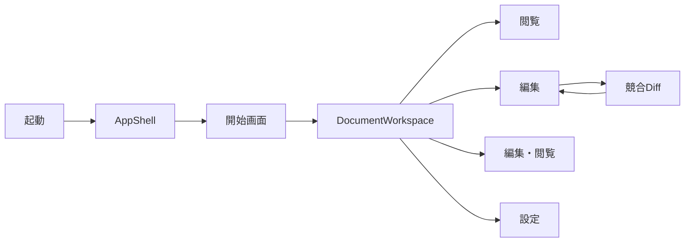
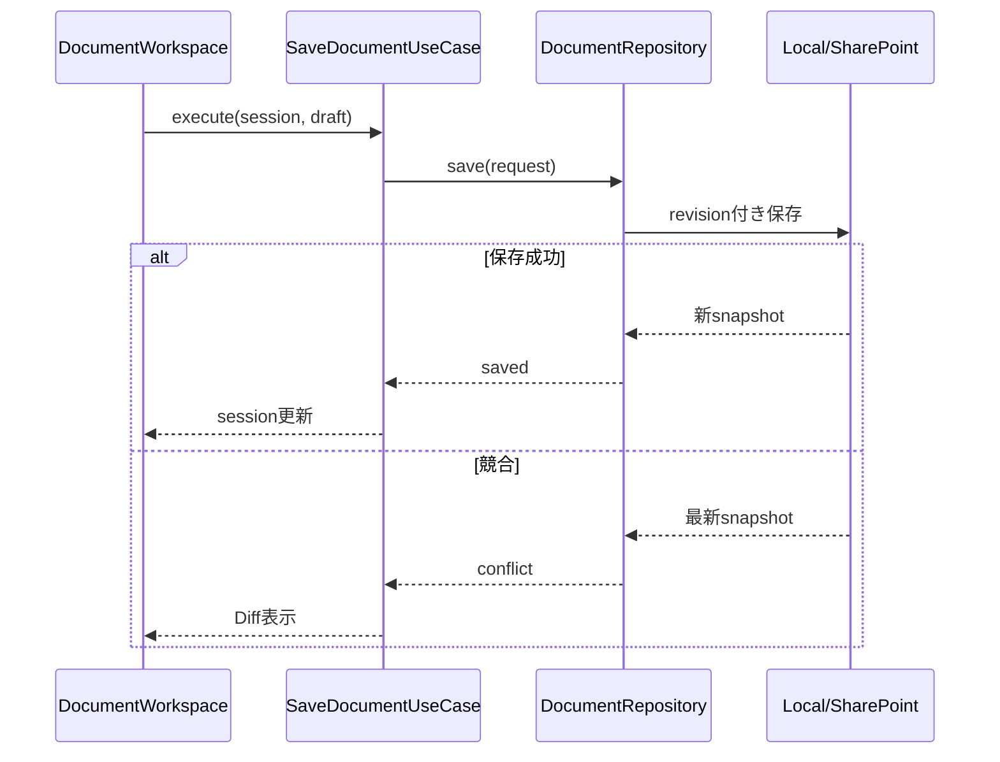

# DES-01 アーキテクチャの責務境界と分割方針

本書は継続利用する設計資料の正本。「現行の責務境界」が実装の配置と変更方法を示す。それ以降の設計案・完了条件は策定時の計画であり、全面移行済みではない。

作成日: 2026-08-30
状態: 部分実装（現行境界と残る設計案を区別）
構想策定版: v0.0.14／現行境界確認版: v0.0.19

## 現行の責務境界

Desktopの`App.tsx`は画面構成と文書セッションの配線を所有する。巨大な汎用controllerへ置き換えるのではなく、独立して入力と結果を検証できる処理から抽出する。既存の保存、revision競合、未保存下書き、Undoの契約を維持する。

| 変更したい責務 | 実装場所 | 維持する境界 |
| --- | --- | --- |
| 終了・タブ操作の非同期確認 | `src/lib/documentActions.ts` | 確認結果は明示的なtrueだけ許可。確認中に対象の本文・保存世代が変わったら中止 |
| 文書種別・表示モード・サイドパネル判定 | `src/lib/applicationViewPolicy.ts` | UI部品は型だけ参照し、TauriやAppを読み込まない |
| プレビューのDOM、選択範囲、検索focus | `src/lib/previewDom.ts` | 対象文書のDOM境界内だけを扱う |
| 文書と外部参照の監視 | `src/hooks/useDocumentWatchTargets.ts` | 文書revisionで再解析し、後着応答を無視。自動更新OFFでも開いたDiffは監視。解除はウィンドウ単位 |
| draw.io・Mermaid・表・テキストの格納形態変換 | `src/lib/fenceStorageConversion.ts` | 形式差を方針へ限定。確認→対象再確認→stage→commitと失敗時discardは共通 |
| Codexモデル候補 | `web-platform/packages/editor-ui/src/features/codex/useCodexModels.ts` | CLI一覧取得だけを所有し、選択値・保存設定・会話を変更しない |
| OSクリップボード | `src-tauri/src/commands/clipboard.rs` | ファイル・BMPの検証とOS出力 |
| 文書診断・監視対象解析 | `src-tauri/src/commands/diagnostics.rs` | Markdown構文、参照パス、見出しとfenceの判定 |
| 外部エディター | `src-tauri/src/commands/editor_launch.rs` | 実行ファイル探索、VS Code workspace判定、引数 |
| SharePoint設定 | `src-tauri/src/commands/sharepoint_settings.rs` | 設定表示と安全なURI検証。認証・通信は既存SharePointサービス |

Rustコマンドは`commands.rs`の再公開を通して既存のTauri名・DTOを維持する。各モジュールのテストは同じモジュール内に置き、テストだけのために内部helperを親へ公開しない。文書保存・asset staging・画像操作とwatcher管理のコマンドは引き続き`commands.rs`に残る。

格納形態変換の`createFenceStorageConverter`はI/Oポートを受け取り、Appの`persistImmediateOccurrence`がrevision確認と下書き保護を担当する。形式を追加する場合は、拡張子・本文整形・空本文の可否・参照構文を方針へ追加し、保存処理を複製しない。ラスタ画像のbase64／バイナリ変換は別経路であり、無理に同じ方針へ混ぜない。外部ファイル削除は変換成功後の明示操作とし、自動削除しない。

単体テストは対象のlib／hookを直接importする。Appの補助関数を試すためにApp全体と全画面の依存を読み込まない。非同期hookは取得取消・後着・失敗時保持・再試行を検証し、GUIやOS出力の受入とは区別する。検証入口は[ビルド・検証コマンド](/docs/developer/BUILD_COMMANDS.md)を参照する。

Appの保存・ナビゲーション・画面構成、Codexの会話保存・候補採用は引き続き既存componentが所有する。以下のapplication-core新設やAppShellへの全面移行は未完了であり、現行境界から独立して段階判断する。

## 策定当時の背景

`src/App.tsx`は文書読込、タブ、保存、競合、印刷、検索、診断、履歴、画像・図表編集、外部操作、各種モーダルを2,583行で管理する。`src-tauri/src/commands.rs`も文書、診断、監視、画像、外部プロセスを2,289行で扱う。同期とAIをこの構造へ直接追加すると、変更範囲、テスト時間、権限監査、AI実装時のコンテキスト量が増大する。

## 目的

- UI、アプリケーションユースケース、外部I/Oを分離する。
- デスクトップとSPFxが同じドメイン型・保存結果・エラー語彙を使う。
- 一つの実装タスクを原則1責務、3〜10ファイルに限定する。
- 現行機能と保存形式を変更せず段階移行する。

## 機能概要

1. `packages/application-core`を新設し、文書セッションと保存ユースケースを定義する。
2. `App.tsx`をAppShell、DocumentWorkspace、DocumentSessionController、NavigationControllerへ分割する。
3. Tauri呼出しを`src/adapters`へ集約する。
4. Rust commandを責務別モジュールへ移し、`lib.rs`は登録だけを行う。
5. デスクトップ／SPFx能力マトリクスを型で表現する。

## ユースケース

### UC-A01 文書を開く

利用者がローカルファイル、`spmd:` URI、SPFxファイル選択から文書を開く。UIは`OpenDocument`ユースケースだけを呼び、取得元の違いを意識しない。

### UC-A02 競合保護付きで保存する

編集中スナップショットのrevision/eTagを渡し、保存成功、競合、権限不足を共通結果で処理する。

### UC-A03 能力に応じて操作を表示する

ローカル文書では外部エディター、SPFxではSharePoint導線、モバイルでは簡易編集だけを表示する。存在しない能力を押して失敗させない。

## 画面遷移



画面構成は変えず、状態所有者だけを分割する。タブバーとステータスバーはAppShell、文書固有モーダルはDocumentWorkspaceが所有する。

## 処理フロー



## データ構造

```ts
export type DocumentSource =
  | { kind: "local"; path: string }
  | { kind: "sharepoint"; uri: string };

export interface DocumentSnapshot {
  source: DocumentSource;
  content: string;
  revision: string;
  format: { encoding: string; lineEnding: "lf" | "crlf" | "cr"; bom: boolean };
  modifiedAt: string;
}

export interface DocumentSession {
  id: string;
  snapshot: DocumentSnapshot;
  draft: string;
  dirty: boolean;
  mode: "edit" | "split" | "preview";
  pendingAssetIds: string[];
}

export interface PlatformCapabilities {
  edit: boolean;
  externalEditor: boolean;
  backgroundSync: boolean;
  cliAi: boolean;
  imageWrite: boolean;
}
```

`DocumentSnapshot`は既存`MarkdownLoadResult`を置換せず、アダプター内で段階変換する。v0.0.14中に外部JSON契約は変更しない。

## API設計

```ts
export interface DocumentRepository {
  load(source: DocumentSource, signal?: AbortSignal): Promise<DocumentSnapshot>;
  save(request: {
    snapshot: DocumentSnapshot;
    content: string;
    pendingAssetIds: readonly string[];
  }): Promise<
    | { status: "saved"; snapshot: DocumentSnapshot }
    | { status: "conflict"; latest: DocumentSnapshot }
  >;
}
```

入力例:

```json
{"snapshot":{"source":{"kind":"local","path":"C:/docs/a.md"},"revision":"sha256:abc"},"content":"# 更新","pendingAssetIds":[]}
```

出力例:

```json
{"status":"saved","snapshot":{"source":{"kind":"local","path":"C:/docs/a.md"},"revision":"sha256:def","content":"# 更新"}}
```

### 対象ファイル

| 操作 | ファイル |
| --- | --- |
| 新規 | `packages/application-core/package.json`、`src/index.ts`、`src/document.ts`、`src/errors.ts`、`src/capabilities.ts` |
| 新規 | `src/app/AppShell.tsx`、`src/features/document/DocumentWorkspace.tsx`、`useDocumentSession.ts` |
| 新規 | `src/adapters/tauriDocumentRepository.ts` |
| 変更 | `src/App.tsx`（構成とイベント配線だけへ縮小） |
| 新規 | `src-tauri/src/commands/document.rs`、`diagnostics.rs`、`process.rs`、`watch.rs` |
| 変更 | `src-tauri/src/commands.rs`、`src-tauri/src/lib.rs` |

### 作成するクラス・関数

| 名前 | 引数 | 戻り値 | 責務 |
| --- | --- | --- | --- |
| `openDocument` | `repository, source, signal?` | `Promise<DocumentSession>` | 読込結果から初期セッションを作る |
| `saveDocument` | `repository, session` | `Promise<SaveDocumentResult>` | 保存と競合結果の正規化 |
| `toDocumentSnapshot` | `MarkdownLoadResult` | `DocumentSnapshot` | 既存Tauri DTO変換 |
| `capabilitiesFor` | `platform, source` | `PlatformCapabilities` | UI能力判定 |

## エラーハンドリング

```ts
export type AppFailure =
  | { code: "not_found"; message: string; retryable: false }
  | { code: "permission_denied"; message: string; retryable: false }
  | { code: "conflict"; message: string; retryable: false }
  | { code: "offline"; message: string; retryable: true }
  | { code: "cancelled"; message: string; retryable: false }
  | { code: "unexpected"; message: string; retryable: boolean; diagnosticId?: string };
```

UIは文字列解析をせず`code`で導線を選ぶ。Rust内部詳細、パス、トークン、HTTP本文は利用者向けmessageへ無制限に含めない。既存commandは当面文字列エラーを返すため、アダプターが既知エラーを変換し、未知値は`unexpected`とする。

## テスト方針

- Unit: `openDocument`、`saveDocument`、能力判定、DTO変換。
- Integration: fake repositoryで読込、保存、競合、キャンセルを通す。
- Component: AppShellとDocumentWorkspaceの状態所有境界を検証する。
- Contract: デスクトップとSPFxが同じfixtureから同じ`DocumentSnapshot`を返す。
- Regression: 既存テストを移動前後で維持し、削除は同等テスト移管後だけ行う。

## Definition of Ready

- v0.0.13未完了受入が分類済みである。
- 既存イベントと状態の所有者一覧が作成済みである。
- 1フェーズで移動する責務が一つに限定されている。
- 公開DTOを変更する場合は移行テストがある。

## 完了条件 / Definition of Done

- `App.tsx`を800行以下、`commands.rs`を登録・再公開中心の400行以下にする。
- 文書読込・保存・競合が`DocumentRepository`経由になる。
- デスクトップとSPFxの共通contract testが成功する。
- 全既存Unit、Component、Rust、SPFxテストとproduction buildが成功する。
- 実画面スモークで主要導線の回帰がない。
- 各新規公開関数にJSDocまたはRust doc commentと入出力例がある。

## 将来拡張案

- SharePoint同期、AI、Git、将来ストレージを同じprovider境界へ追加する。
- React UI部品の一部をWeb Componentsまたは共有headless modelへ移す。
- Windows以外を正式対応する場合もOS adapterを置換できるが、本ロードマップでは対象外とする。
