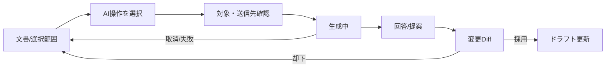

# DES-06 AI実装支援設計

本書は継続利用する設計資料の正本。対象版・状態・完了条件は策定時の計画を示し、現在の実装済み範囲を保証しない。実装や再開の判断は現在の要求とソースで確認する。

> 2026-09-08追記: v0.0.15ではWindowsデスクトップ専用の任意Codex CLI連携を先行実装した。現行仕様は[Codex利用ガイド](/docs/user/ui/codex.md)を参照。本書のv0.0.16表記は汎用AI支援の将来設計であり、全機能の実装済みを意味しない。

作成日: 2026-08-30
状態: DEFERRED
対象版: v0.0.16

## 背景

ユーザーは、利用者がAPIキーを設定する方式と、Claude CLI・Codex CLI等の既存サブスクリプションを利用するCLI方式の双方を要求している。対象機能は校正、要約、質問、構成提案、Markdown／表／図表生成、診断、複数文書、直接編集案である。AIは誤りや意図しない変更を起こし得るため、元ファイルへ直接書き込ませない。

## 目的

- APIとCLIを同じprovider contractで扱う。
- 送信文書、送信先、見積サイズを実行前に表示する。
- AI出力を提案または一時パッチとして扱い、ファイル単位のDiff承認後だけ保存する。
- 文書内命令をデータとして扱い、アプリ権限をAIへ委譲しない。
- 小型モデルでも機能単位にprovider非依存で実装・テストできるようにする。

## 機能概要

### 初期機能群

1. 選択範囲の校正・書き換え
2. 文書要約
3. 文書への質問
4. 見出し構成・目次改善
5. Markdown、表、Mermaid、draw.io生成
6. リンク切れ、表記揺れ、機密候補等の診断
7. 利用者が選択した複数文書への検索・質問
8. 一時ワークスペース上の直接編集案

機能は一つの汎用chatへ詰め込まず、入力・出力schemaを持つ個別commandとして提供する。

## ユースケース

### UC-I01 選択範囲を校正する

選択範囲、前後の限定context、指示をproviderへ送り、原文／提案Diffを表示する。「採用」で現在ドラフトだけを更新し、文書保存は既存保存操作に従う。

### UC-I02 複数文書へ質問する

利用者が対象ファイルを選び、アプリが見出し単位でchunk化する。providerへ必要chunkだけを送り、回答にはファイル名と見出しを根拠として付ける。

### UC-I03 CLIに編集案を作らせる

選択文書を一時ワークスペースへ複製し、既知CLIをshellなしで起動する。CLIは一時コピーだけを変更し、終了後にアプリが差分を読み、ファイル単位に承認する。削除・名称変更・元フォルダー外書込みは初期版で不許可とする。

## 画面遷移



AIパネルにはprovider、モデルまたはCLI名、対象文書、送信量、停止、結果の根拠を常時表示する。

## 処理フロー

### API provider

1. UIがtyped `AiCommand`を作る。
2. scope resolverが対象文書とchunkを確定する。
3. security policyがhost、データ分類、byte上限を検査する。
4. SecretStoreからAPIキーをRust内だけで取得する。
5. Rust HTTP clientがstreamを受信し、秘密を除いたeventをUIへ送る。
6. structured outputを検証し、提案またはpatchへ変換する。

### CLI provider

1. executableを既知パスまたは利用者指定パスから解決し、版とログイン状態を検出する。
2. `tempfile`の一時workspaceへ対象ファイルをコピーする。
3. shellを介さず引数配列でCLIを起動する。
4. timeout、出力、ファイル数、総byte上限を監視する。
5. 一時workspaceの変更を読み、元snapshotとのpatchを生成する。
6. 一時領域を削除し、承認済みpatchだけを既存保存境界へ渡す。

## データ構造

```ts
export type AiCommandKind =
  | "rewrite" | "summarize" | "question" | "outline"
  | "generate" | "diagnose" | "multi_document_question" | "edit_files";

export interface AiRequest {
  id: string;
  kind: AiCommandKind;
  providerId: string;
  instruction: string;
  documents: Array<{
    sourceKey: string;
    displayName: string;
    revision: string;
    content: string;
    selectedRange?: { from: number; to: number };
  }>;
  output: "text" | "markdown" | "diagnostics" | "file_patch";
}

export interface FilePatchProposal {
  sourceKey: string;
  baseRevision: string;
  original: string;
  proposed: string;
  summary: string;
  warnings: string[];
}
```

AI実行履歴へ保存するのはprovider ID、command kind、時刻、対象数、成否、token/時間概算、診断IDだけとする。本文、prompt、回答、APIキーはSQLiteへ保存しない。

## API設計

```ts
export interface AiProvider {
  describe(): Promise<{
    id: string;
    mode: "api" | "cli";
    capabilities: AiCommandKind[];
    configured: boolean;
    displayName: string;
  }>;
  run(
    request: AiRequest,
    sink: (event: AiEvent) => void,
    signal?: AbortSignal
  ): Promise<AiResult>;
}
```

入力例:

```json
{"kind":"rewrite","providerId":"api-openai-compatible","instruction":"簡潔な日本語にする","documents":[{"sourceKey":"C:/docs/a.md","revision":"sha256:abc","content":"冗長な文章","selectedRange":{"from":0,"to":5}}],"output":"file_patch"}
```

出力例:

```json
{"status":"proposal","patches":[{"sourceKey":"C:/docs/a.md","baseRevision":"sha256:abc","original":"冗長な文章","proposed":"簡潔な文章","summary":"表現を簡潔化","warnings":[]}]}
```

### 対象ファイル

| 操作 | 対象 |
| --- | --- |
| 新規 | `packages/application-core/src/ai/model.ts`、`commands.ts`、`provider.ts`、`patch.ts` |
| 新規 | `src/features/ai/AiPanel.tsx`、`AiScopeDialog.tsx`、`AiProposalWorkspace.tsx` |
| 新規 | `src/features/ai/useAiRun.ts`、`useAiProviders.ts` |
| 新規 | `src/adapters/tauriApiAiProvider.ts`、`tauriCliAiProvider.ts` |
| 新規 | `src-tauri/src/ai/api.rs`、`cli.rs`、`workspace.rs`、`stream.rs` |
| 変更 | `src/components/DocumentDiffWorkspace.tsx`（提案モード） |
| 変更 | SQLite migration `0003_ai_runs.sql` |

### 作成するクラス・関数

| 名前 | 引数 | 戻り値 |
| --- | --- | --- |
| `buildRewriteRequest` | `selection, instruction, providerId` | `AiRequest` |
| `chunkDocuments` | `snapshots, maxChars` | `DocumentChunk[]` |
| `validateAiResult` | `request, unknown` | `AiResult` |
| `createTemporaryWorkspace` | `snapshots` | `TemporaryAiWorkspace` |
| `runCliProvider` | `CliRunRequest, limits` | `CliRunResult` |
| `buildPatchProposals` | `workspaceResult, baseSnapshots` | `FilePatchProposal[]` |
| `applyApprovedProposal` | `session, proposal` | `DocumentSession` |

## エラーハンドリング

- api_key_missing/invalid: 設定導線を表示し、入力内容を保持する。
- cli_not_found/not_logged_in: 検出結果と公式CLI側で必要な操作だけを案内する。
- rate_limited: `Retry-After`を表示し、自動連打しない。
- context_too_large: 文書を勝手に除外せず、対象縮小候補を示す。
- invalid_structured_output: 原文を変更せず、回答テキストを参考表示する。
- base_revision_changed: 提案適用を拒否し、最新文書とのDiffを再生成する。
- timeout/output_limit/file_limit: 子processを終了し、一時workspaceを破棄する。
- cancellation: stream/processを停止し、部分提案を採用不可にする。
- prompt injection: 文書内命令による追加tool、外部通信、対象拡大を許可しない。

## テスト方針

- Unit: request builder、chunk、schema検証、patch、revision guard、redaction。
- Integration: fake API stream、fake CLI executable、一時workspace、timeout、cancel、部分出力。
- Contract: API/CLI providerが同じevent順序と結果schemaを満たす。
- E2E: 校正→Diff→採用→既存保存、複数文書質問、CLI一時編集。
- Security: APIキー非露出、shell injection、path traversal、prompt injection、巨大出力、symlink。
- Performance: 100KB文書のchunk生成100ms以下、stream中のUI操作応答を維持する。

## Definition of Ready

- 対象文書のデータ区分と送信同意文面が確定している。
- 初期対応API provider、Claude CLI、Codex CLIの実際の入出力契約と版が検証済みである。
- SPFxのAI接続方式が未確定の場合、デスクトップ限定表示が承認されている。
- DES-03、DES-04が完了している。

## 完了条件 / Definition of Done

- API/CLI両方式で校正、要約、質問、構成、生成、診断、複数文書、編集提案をprovider非依存に実行できる。
- 元ファイルはDiff承認前に変更されない。
- base revision不一致時に提案を適用しない。
- APIキー、token、文書本文、promptがDB・ログ・DOM属性へ残らない。
- cancel、timeout、CLI異常終了後に子processと一時workspaceが残らない。
- AI無効状態でアプリ起動・閲覧・編集性能が悪化しない。

## 将来拡張案

- ローカルモデル、組織管理AI endpoint、モデル別費用上限を内部providerとして追加する。
- 利用者が保存を選んだ場合だけAI会話履歴を暗号化保存する。
- 検証可能な引用、Markdown AST patch、構造化図表lintを追加する。
- 外部プラグイン方式は別途sandbox設計が承認されるまで採用しない。

## v0.0.15 Codex通信ログの例外

ユーザー要求による任意Codex CLI連携では、成功した送信プロンプト（対象本文・会話を含む）、応答、JSONLをアプリのローカル領域のcodex-log.jsonへ保存する。既定20件、1〜1,000件で設定する。一般診断ログや将来のSQLite履歴への本文非記録方針とは区別する。アプリは認証情報をログ項目として取得しないが、利用者が本文に含めた情報はそのまま記録される。検証では件数制限・原子的保存・受信表示を確認する。
