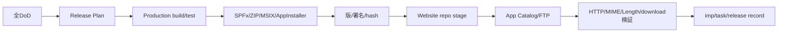

# CI・リリース・セキュリティ運用

作成日: 2026-08-30
状態: PROPOSED

## 背景

現行はローカルの大量test、ガード付きPowerShell release、MSIX/App Installer、SPFx App Catalog、FTP公開後検証を持つが、PR単位のCIとOSS運用文書がない。MIT OSS化と同格2製品を支えるため、再現可能な品質ゲートを設ける。

## 目的

- ローカル記録だけでなくPRとreleaseごとに検証証跡を残す。
- desktop、SPFx、配布サイトの版と成果物を一致させる。
- 秘密をリポジトリ・ログ・artifactへ出さない。
- 失敗した公開を安全に再開・rollbackできるようにする。

## ブランチと版

- `main`: 公開可能な安定基準。
- `feature/vX.Y.Z`: 版単位の実装。
- manifest版はroot、markdown-core、Tauri、SPFxで同期する。
- betaは既存beta channelへ公開し、stableは明示指示まで実行しない。

## CI設計

`ci.yml`を次のjobへ分割する。

1. `frontend`: npm clean install、core build、typecheck、Vitest、coverage、Vite build
2. `rust`: fmt check、clippy、test、llvm-cov
3. `spfx`: npm clean install、Heft test/build
4. `e2e-web`: Playwright browser harness、axe、responsive screenshot
5. `security`: secret scan、dependency audit、license report
6. `package-plan`: release Plan/WhatIf、版整合性、script self-test

依存installはlockfileを正本にする。rootに`package-lock.json`と`pnpm-lock.yaml`が併存しているため、v0.0.14でpackage managerをnpmへ統一するかpnpmへ統一するかを決め、片方だけをCI正本にする。現行scriptsがnpm中心のためnpmを暫定推奨とする。

## リリースフロー

公開処理は既存ガード付きscriptを利用し、秘密を引数・標準出力・commitへ含めない。App Catalogへの全サイト展開は明示指示がある場合だけ行う既存方針を維持する。

## セキュリティ運用

- `SECURITY.md`: 対応version、非公開報告方法、初動目標を記載する。
- Critical: 24時間以内に受領確認、72時間以内に緩和判断。
- High: 3営業日以内に評価、次のbetaまたは緊急版で対応。
- dependency exceptionにはCVE、影響経路、緩和、期限、ownerを付ける。
- API key、PFX、FTP、tenant secretはCI secret storeに保存し、fork PRへ渡さない。
- release artifactはhash、署名者、build commit、tool versionを記録する。

## OSS文書

v0.0.14公開前に次を追加する。

- `LICENSE`（MIT License）
- `SECURITY.md`
- `CONTRIBUTING.md`
- `CODE_OF_CONDUCT.md`
- `THIRD_PARTY_NOTICES.md`または自動生成artifact
- issue/PR template

実tenant名、実配布credential、個人パスをsampleやissue templateへ含めない。現在文書に含まれる公開URL・tenant例は、OSS公開前に公開可能性を個別確認する。

## エラーハンドリングとrollback

- build/test失敗: package/publishへ進まない。
- 署名/hash不一致: stageしない。
- App Catalog失敗: Web配布の可否を独立判断し、SPFx完了と記録しない。
- FTP一部失敗: remote検証で不足を列挙し、同一成果物から再送する。
- 公開後破損: beta記事を停止表示へ切替え、直前正常成果物をrollback候補にする。
- DB migration不具合: 文書本体は影響させず、旧JSON fallbackまたは前schema対応版へ戻せるようにする。

## 監視とログ

運営telemetryは送信しない。ローカルdiagnosticは次を守る。

- 既定でtoken、API key、本文、prompt、完全pathを記録しない。
- 利用者が明示exportしたdiagnostic bundleだけをissueへ添付できる。
- bundle生成前にpreviewとredaction結果を表示する。
- sync/AIのdiagnostic ID、error code、時刻、provider IDは記録できる。

## 完了条件

- PRで全必須jobが再現可能に動く。
- beta releaseがcommitから公開後downloadまで追跡できる。
- secret scanと第三者license reportが公開ゲートになる。
- rollbackまたは公開停止の演習記録がある。
- ローカルだけで同じtest/buildを実行する日本語手順が`README`または`scripts/README.md`にある。

## 将来拡張

- reproducible build、SBOM、SLSA provenance、MSIXの信頼済み公開証明書へ段階移行する。
- SPFx packageとMSIXのrelease notesを共通change modelから生成する。
- 組織運用向けの長期サポートbranchはv1.0後に検討する。
