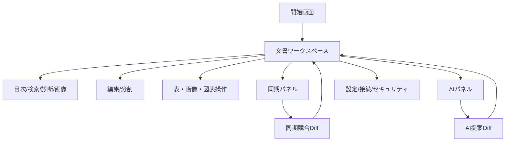

# MarkdownViewer GUI/UX提案

作成日: 2026-08-30
状態: PROPOSED
対象: Windowsデスクトップ、SPFx desktop/mobile

## 1. 背景

機能増加により、プレビュー、編集、表、画像、図表、診断、印刷、同期、将来AIが同じ画面へ集まりつつある。初心者の「開いて読む・少し直して保存」と、上級者の「構造編集・外部ファイル・AI/CLI・診断」を同じ密度で常時表示すると、発見性と学習コストの両方が悪化する。

## 2. 目的

- 初心者は文書を開き、読み、編集し、保存するまで迷わない。
- 上級者はkeyboardとcommand searchで深い機能へ素早く到達する。
- desktopとSPFxで操作名、状態、エラー、保存意味を一致させる。
- offline、同期中、競合、AI送信、未保存を見分けられる。
- dark、狭幅、touch、screen readerで主要操作を完結できる。

## 3. 情報設計

### 常時表示するもの

- タブ／文書名、未保存記号
- 閲覧／編集／分割モード
- 保存
- 文書本文
- 現在の保存元、同期状態、zoom

### 文脈時だけ表示するもの

- 表、画像、Mermaid、draw.ioの操作は対象block内toolbar
- 検索、目次、診断、画像一覧は一つのside panel
- AIは選択範囲または文書actionから開くside panel
- 同期詳細、provider、securityはstatus buttonから開く

### 上級者向け

- `Ctrl+Shift+P`相当のcommand searchは過去に対象外だったが、機能増加後の発見性改善として再評価候補とする。v0.0.14では内部command registryだけを整え、UI追加は別途承認後とする。
- shortcut help、context menu、外部エディター、diagnosticsを維持する。

## 4. 画面遷移



## 5. Desktopワークスペース

### ワイヤーフレーム

```text
┌─────────────────────────────────────────────────────────────────────┐
│ [doc-a.md *] [doc-b.md]                                      [＋] │
├─────────────────────────────────────────────────────────────────────┤
│ [閲覧][編集/閲覧][編集]  [保存]  [再読込]        [検索] [その他…] │
├───────────────┬─────────────────────────────────────────────────────┤
│ 目次 検索     │ # 設計書                                            │
│ 診断 画像     │                                                     │
│               │ 本文…                                               │
│ ▸ 1. 概要     │ ┌ Mermaid ─────────────────────── [編集] [コピー] ┐ │
│ ▸ 2. 設計     │ │                     図                          │ │
│               │ └─────────────────────────────────────────────────┘ │
├───────────────┴─────────────────────────────────────────────────────┤
│ SharePoint • 同期済み 12:30   UTF-8  LF   100%   Auto      [⚙][?] │
└─────────────────────────────────────────────────────────────────────┘
```

### コンポーネント一覧

| コンポーネント | 役割 | Keyboard |
| --- | --- | --- |
| `AppTabBar` | 文書・設定タブ、未保存 | Ctrl+Tab、Ctrl+W |
| `DocumentModeSegment` | 閲覧/分割/編集 | command registry経由 |
| `PrimaryDocumentActions` | 保存、再読込 | Ctrl+S、F5 |
| `DocumentSidePanel` | 目次、検索、診断、画像 | Ctrl+F、Esc |
| `DocumentCanvas` | preview/editor/presentation | 文脈依存 |
| `BlockActionBar` | 表、画像、図表操作 | Tab、Enter、menu arrow |
| `DocumentStatusBar` | source、sync、encoding、zoom | buttonとしてfocus可能 |
| `ToastRegion` | 成功・警告・error | live region、action focus可能 |

### 操作フロー

初心者:

1. ファイル関連付けまたはSharePointから文書を開く。
2. 既定は閲覧。編集を押すとCodeMirrorへ移る。
3. 保存が必要なときだけprimary buttonが有効になる。
4. 競合時は自動上書きせずDiffへ案内する。

上級者:

1. shortcutでmode、検索、保存、タブを操作する。
2. block toolbarまたはcontext menuから表・図表・外部化を行う。
3. diagnostics、sync、AIはside panelで同じ文書contextを維持する。

## 6. 開始画面

```text
┌──────────────────────────────────────────────────┐
│ MarkdownViewer                                   │
│                                                  │
│ Markdownファイルをドロップ                       │
│ または                                            │
│ [新規Markdown] [最近使った文書] [SharePoint]     │
│                                                  │
│ 最近使った文書                                   │
│ ・仕様書.md                         10分前       │
│ ・SharePoint / team / README.md      昨日        │
└──────────────────────────────────────────────────┘
```

- 最近使った項目はSQLite補助情報から表示する。
- 引数や関連付けで開いた場合は開始画面を経由しない。
- 欠落文書をクリックした場合は一覧全体を消さず、再指定／削除を提示する。

## 7. 同期パネル（v0.0.15）

```text
┌ 同期 ───────────────────────────────┐
│ ● 同期済み                          │
│ SharePoint / Team / docs / spec.md  │
│ 最終確認 12:30  次回 12:35          │
│ [今すぐ同期] [一時停止] [対象解除]  │
│                                     │
│ 競合がある場合                      │
│ ! SharePointにも変更があります      │
│ [差分を確認]                        │
└─────────────────────────────────────┘
```

状態はicon＋文言で示す。同期中animationは`prefers-reduced-motion`で静的表示へ変える。offlineは自動保存済みと誤認させない。

## 8. AIパネルと提案Diff（v0.0.16）

```text
┌ AI支援 ─────────────────────────────┐
│ Provider: Codex CLI                 │
│ 操作: 選択範囲を校正                │
│ 対象: spec.md / 選択 420文字        │
│ 外部送信: CLI一時workspace          │
│                                     │
│ 指示 [簡潔な日本語にする________]   │
│ [実行] [取消]                       │
├─────────────────────────────────────┤
│ 提案                                │
│ - 冗長表現を2箇所修正               │
│ [差分を確認]                        │
└─────────────────────────────────────┘
```

Diff画面:

```text
┌ AI変更案: spec.md ───────────────────────────────────┐
│ Provider / 対象revision / 警告                       │
├──────────────────────┬───────────────────────────────┤
│ 現在の内容           │ 提案                          │
│ - 元の文章           │ + 修正した文章               │
├──────────────────────┴───────────────────────────────┤
│ [却下] [ドラフトへ採用]                              │
└───────────────────────────────────────────────────────┘
```

- 「採用」は元ファイル保存ではなく現在draft更新であることを明記する。
- 複数ファイルでは左にfile listと採用状態を表示し、全採用を既定にしない。
- API送信時はprovider host、文書数、文字数を表示する。

## 9. 設定・接続・セキュリティ

設定タブを次のカテゴリに分ける。

1. 表示: theme、layout、font、Markdown CSS
2. 編集: 段落、shortcut、保存挙動
3. 接続: SharePoint、AI API、CLI検出
4. 同期: 対象、間隔、停止
5. セキュリティ: 外部通信、PowerShell、CLI、保存済みsecretの削除
6. 詳細: 外部アプリ、diagnostic、設定folder

検索欄を設定上部へ置く。APIキーはpassword fieldへ再表示せず「登録済み ••••1234」「更新」「削除」だけを示す。

## 10. SPFxモバイル

### ワイヤーフレーム 390px

```text
┌────────────────────────────┐
│ spec.md *           [⋮]    │
├────────────────────────────┤
│ [閲覧] [編集]      [保存]  │
├────────────────────────────┤
│ # 設計                     │
│                            │
│ 本文…                      │
│                            │
│ ┌ 表 ─────────────── [⋮] ┐ │
│ │ 横に収まらない場合は    │ │
│ │ 表内部だけ横scroll      │ │
│ └────────────────────────┘ │
├────────────────────────────┤
│ [目次] [検索] [状態]       │
└────────────────────────────┘
```

- 320〜767pxではside panelをbottom sheetまたはdrawerにする。
- 表だけは内部横scrollを許可し、ページ全体を横scrollさせない。
- 簡易編集は本文入力、基本toolbar、Undo/Redo、保存、競合Diffを対象とする。
- 画像注釈やdraw.io編集等の複雑機能は能力理由付きでdesktop利用を案内できる。

## 11. 配色案

既存theme tokenを整理し、意味を固定する。

| Token | Light例 | Dark例 | 用途 |
| --- | --- | --- | --- |
| `--surface` | `#FFFFFF` | `#1E1E1E` | 本文・panel |
| `--surface-subtle` | `#F5F7FA` | `#252526` | toolbar、code header |
| `--text` | `#1F2328` | `#E6EDF3` | 本文 |
| `--text-muted` | `#59636E` | `#A8B3BE` | 補助情報 |
| `--border` | `#D0D7DE` | `#444C56` | 区切り |
| `--accent` | `#0969DA` | `#58A6FF` | focus、link、primary |
| `--success` | `#1A7F37` | `#3FB950` | 保存・同期成功 |
| `--warning` | `#9A6700` | `#D29922` | offline、未確定 |
| `--danger` | `#CF222E` | `#F85149` | error、拒否 |

値は例であり、実装時に実背景上のcontrastを自動testする。同期やerrorを色だけで表現せずiconと文言を併用する。

## 12. Keyboard・アクセシビリティ

- native button/input/selectを使用し、div role buttonを増やさない。
- tab順は画面の読み順と一致させ、正の`tabIndex`を使わない。
- modal/drawerは共通focus trap、初期focus、Esc、起点復帰を使用する。
- side panelのtabはarrow key、内容は通常Tabで移動する。
- toolbar overflow menuはroving focusまたは標準menu patternを一つに統一する。
- 保存、同期、AI結果は`aria-live=polite`、破壊的errorは必要時だけalertを使う。
- code、diagram、imageには意味あるaccessible name/altを保つ。
- shortcutは表示文字と実装registryから生成し二重管理しない。

## 13. 検索性・発見性・学習コスト

- 初回は閲覧・編集・保存・検索だけを見せる。
- 初めて表/図表へpointerまたはfocusした時だけblock操作を表示する。
- 「その他」は低頻度操作を格納し、主要操作と同時に重複表示しない。
- 空状態に一文の説明と一つの次actionを置く。
- 設定とshortcut helpから同じ操作名を検索できるcommand registryを作る。
- onboarding tourは強制せず、必要時に再表示できる3ステップ以内のtipとする。

## 14. エラー・状態表示

| 状態 | 表示 | 主action |
| --- | --- | --- |
| 未保存 | tab `*`＋status文言 | 保存 |
| 外部更新 | warning bar | Diff確認／再読込 |
| offline | status icon＋「未同期」 | 再試行／同期停止 |
| 競合 | persistent banner | Diff確認 |
| 権限不足 | 操作disabled＋理由 | 再認証／管理者へ連絡 |
| AI生成中 | provider、対象、経過、停止 | 取消 |
| AI提案 | 「未適用」表示 | Diff確認 |

toastだけで重要状態を伝えない。競合・offline・未適用AI提案は状態が解消するまで再確認可能にする。

## 15. UIテストと完了条件

- 320、390、768、1024、1440pxのPlaywright screenshotをlight/darkで比較する。
- keyboard E2E、axe重大違反0、200% text zoom、reduced motionを検証する。
- beginner scenario「開く→検索→編集→保存」を5操作群以内で完了する。
- advanced scenario「診断→該当箇所→Diff→外部図編集」をkeyboard中心で完了する。
- 同じ操作名と保存意味がdesktop/SPFxで一致する。
- GUI変更は実画面で5秒入力監視後に確認し、対象画面を証跡保存する。

## 16. 将来拡張案

- 利用状況telemetryは採用しない方針のため、改善調査は任意のユーザーテストとissue templateで行う。
- command paletteは内部registryの有効性を確認後に別途採否を決める。
- 高コントラスト専用theme、音声読み上げ最適化、組織brand themeを検討する。
