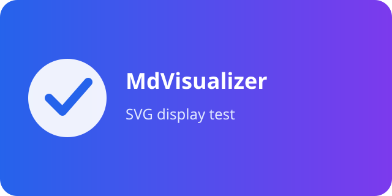
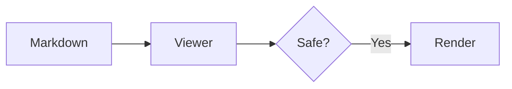

# MdVisualizer 対応記法・総合サンプル

このファイルは、MdVisualizerが対応する主要なMarkdown/GFM記法を一度に確認するための資料です。
[ローカルリンクの確認](local-links.md)と[Mermaidギャラリー](mermaid-gallery.md)は新しいタブで開きます。
[OpenAI](https://openai.com/)は外部ブラウザで開きます。

## 文字装飾

通常、**太字**、*斜体*、***太字斜体***、~~取り消し線~~、`inline code`、
エスケープした \* 記号、URLの自動リンク <https://example.com/>。

> 引用の第1段です。
>
> > ネストした引用です。

---

## リスト

1. 番号付き項目
   1. ネスト項目
   2. もう一つ
2. 続き

- 箇条書き
  - ネスト
- [x] 完了タスク
- [ ] 未完了タスク

## 見出しレベル

### H3

#### H4

##### H5

###### H6

各見出しをクリックし、折りたたみと展開を確認します。

## 表

| 左寄せ | 中央 | 右寄せ | 長いセル |
| :--- | :---: | ---: | :--- |
| Alpha | `code` | 123 | 長い日本語テキストがセル幅に合わせて折り返されます |
| [link](linked-document.md) | **bold** | 456 | ライトテーマでも見出し文字が読めること |

## コード

```typescript
type Greeting = { name: string };
const greet = ({ name }: Greeting) => `Hello, ${name}`;
```

```rust
fn main() {
    println!("Hello from Rust");
}
```

    function indentedCodeBlock() {
      return "先頭を4文字分インデントしたコード";
    }

## HTML許可リスト

<details>
<summary>安全なHTMLの表示</summary>
<strong>strong</strong> と <kbd>Ctrl</kbd> + <kbd>F</kbd>
</details>

## 画像

### ラスター画像（表示縮小・クロップ対応）


### ラスター画像（インデントされた画像）

  

### SVG画像（表示専用）



## Mermaid



詳細は[Mermaidギャラリー](mermaid-gallery.md)を参照してください。
