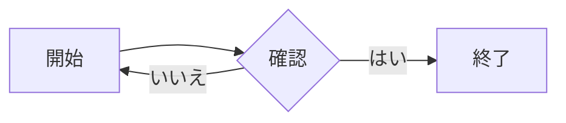

# コピー・描画回帰テスト

このファイルは、MarkdownViewerのコピーと図の表示を確認するためのテストデータです。

## 1. 箇条書き直下のコードブロック

- 親項目
  ```ts
  const nestedCode = true;
  console.log(nestedCode);
  ```
  - 子項目
    ```ts
    const deeplyNested = "ok";
    ```

## 2. 埋め込み画像


画像を右クリックして「名前変更」を実行し、見出し（画像のタイトル）とファイル名の編集欄を確認します。画像を拡大したときも、この見出しがタイトルに表示されます。

## 3. Mermaid図



図の上で右クリックするとBMP画像をクリップボードへコピーします。ペイントを開いて貼り付けできること、ツールバーの「BMPコピー」でも同じ結果になることを確認します。

## 4. draw.io図

```drawio
<mxGraphModel dx="800" dy="600" grid="1" gridSize="10" page="1" pageScale="1" pageWidth="850" pageHeight="1100">
  <root>
    <mxCell id="0" />
    <mxCell id="1" parent="0" />
    <mxCell id="2" value="開始" style="rounded=1;whiteSpace=wrap;html=1;" vertex="1" parent="1">
      <mxGeometry x="80" y="80" width="120" height="60" as="geometry" />
    </mxCell>
    <mxCell id="3" value="終了" style="rounded=1;whiteSpace=wrap;html=1;" vertex="1" parent="1">
      <mxGeometry x="280" y="80" width="120" height="60" as="geometry" />
    </mxCell>
    <mxCell id="4" edge="1" parent="1" source="2" target="3">
      <mxGeometry relative="1" as="geometry" />
    </mxCell>
  </root>
</mxGraphModel>
```

## 5. 既定コピー

プレビュー上で右クリックして「コピー」を選ぶと、表示テキストではなく元のMarkdownがクリップボードへ入ります。「プレーンテキストでコピー」は表示内容だけをコピーする明示操作です。
