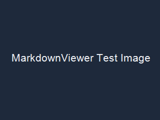

# v0.0.7 カスタマイズ確認

## 単一サイドパネル

左端の「目次」「検索」「画像」を切り替え、同時に1種類だけ表示されることを確認します。



## シンタックス配色

設定タブでAdaptive、GitHub Light／Dark、Monokai、Solarized Darkと基本色上書きを切り替えます。

```typescript
const message = "syntax highlight";
console.log(message);
```

## PowerShell確認実行

次のボタンはクリックしただけでは実行されません。確認画面のコード、作業フォルダー、制限を確認してから実行します。

```pwsh
Write-Output "MarkdownViewer v0.0.8"
Get-Location
```

## 印刷スタイル

設定タブで見出し色、罫線色、背景色、本文フォント、白黒印刷を変更し、通常表示とプレゼン表示の印刷プレビューを確認します。

> 引用背景と左罫線も印刷設定の色から生成されます。

---

## 下位見出し

### 印刷色の確認

### 白黒モードの確認
