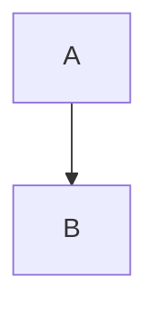

# Markdownエディタ動作検証用サンプル

## 番号

1. asd
  1. xxx
    1. hoge
     - asdasd
       - asd
         - asdads
           - ads
2. asd
  1. xxx
    1. hoge
     - asdasd
       - asd
      
1. aaa
2. cccc
3. bbb
4. dddd
aaa

bbbb


before
```
- 1行目


- 2行目
```

after
```
- 1行目

- 2行目
```

理想
```
- 2行目
- 1行目
```


## asxxxasdasdasdsad


**`edit-1 - editの1つ目の図`**

```drawio
<mxGraphModel dx="1414" dy="828" grid="1" gridSize="10" guides="1" tooltips="1" connect="1" arrows="1" fold="1" page="1" pageScale="1" pageWidth="827" pageHeight="1169" math="0" shadow="0">
      <root>
        <mxCell id="0"/>
        <mxCell id="1" parent="0"/>
        <mxCell id="pq9SdDX981i02IKlm9TC-3" edge="1" parent="1" source="pq9SdDX981i02IKlm9TC-1" style="edgeStyle=orthogonalEdgeStyle;rounded=0;orthogonalLoop=1;jettySize=auto;html=1;" target="pq9SdDX981i02IKlm9TC-2" value="">
          <mxGeometry relative="1" as="geometry"/>
        </mxCell>
        <mxCell id="pq9SdDX981i02IKlm9TC-1" parent="1" style="rounded=1;whiteSpace=wrap;html=1;fillColor=#f8cecc;strokeColor=#b85450;" value="xxx" vertex="1">
          <mxGeometry height="60" width="120" x="340" y="570" as="geometry"/>
        </mxCell>
        <mxCell id="pq9SdDX981i02IKlm9TC-2" parent="1" style="rounded=1;whiteSpace=wrap;html=1;fillColor=#f8cecc;strokeColor=#b85450;" value="asdads" vertex="1">
          <mxGeometry height="60" width="120" x="540" y="570" as="geometry"/>
        </mxCell>
        <mxCell id="pq9SdDX981i02IKlm9TC-4" parent="1" style="shape=umlActor;verticalLabelPosition=bottom;verticalAlign=top;html=1;outlineConnect=0;" value="Actor" vertex="1">
          <mxGeometry height="60" width="30" x="260" y="570" as="geometry"/>
        </mxCell>
        <mxCell id="pq9SdDX981i02IKlm9TC-5" parent="1" style="swimlane;whiteSpace=wrap;html=1;" value="Vertical Container" vertex="1">
          <mxGeometry height="200" width="200" x="330" y="330" as="geometry"/>
        </mxCell>
        <mxCell id="pq9SdDX981i02IKlm9TC-6" parent="pq9SdDX981i02IKlm9TC-5" style="rhombus;whiteSpace=wrap;html=1;shapeInside=1;fillColor=#e1d5e7;strokeColor=#9673a6;" value="" vertex="1">
          <mxGeometry height="80" width="80" x="70" y="60" as="geometry"/>
        </mxCell>
        <mxCell id="pq9SdDX981i02IKlm9TC-7" edge="1" parent="1" source="pq9SdDX981i02IKlm9TC-6" style="edgeStyle=orthogonalEdgeStyle;rounded=0;orthogonalLoop=1;jettySize=auto;html=1;entryX=0.45;entryY=0.017;entryDx=0;entryDy=0;entryPerimeter=0;" target="pq9SdDX981i02IKlm9TC-1">
          <mxGeometry relative="1" as="geometry"/>
        </mxCell>
        <mxCell id="wQgrL-DASGqJ4cI0L9Po-1" parent="1" style="shape=cylinder3;whiteSpace=wrap;html=1;boundedLbl=1;backgroundOutline=1;size=15;fillColor=#e1d5e7;strokeColor=#9673a6;" value="" vertex="1">
          <mxGeometry height="80" width="60" x="420" y="660" as="geometry"/>
        </mxCell>
        <mxCell id="wQgrL-DASGqJ4cI0L9Po-2" edge="1" parent="1" source="pq9SdDX981i02IKlm9TC-1" style="edgeStyle=orthogonalEdgeStyle;rounded=0;orthogonalLoop=1;jettySize=auto;html=1;exitX=0.5;exitY=1;exitDx=0;exitDy=0;entryX=0;entryY=0.5;entryDx=0;entryDy=0;entryPerimeter=0;" target="wQgrL-DASGqJ4cI0L9Po-1">
          <mxGeometry relative="1" as="geometry"/>
        </mxCell>
      </root>
    </mxGraphModel>
```


**`edit-3`**



**`code`**

```cpp
sub asd()
  asd
end sub
```


asdasdasdasdad


a


