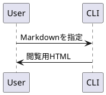

# 単一HTMLの出力サンプル

この文書には、**日本語の本文**、表、コード、図を含めています。
出力したHTMLは、Markdownや画像フォルダーを一緒に配布せずに閲覧できます。

- [x] 本文をHTMLとして保存
- [x] 図をファイル内へ埋め込み
- [x] 閲覧時のJavaScriptを不要にする

## Mermaidの図


## 表

```csv
項目,件数
本文,10
図,3
合計,
```

## SVGの図

```svg
<svg xmlns="http://www.w3.org/2000/svg" viewBox="0 0 480 110">
  <rect width="480" height="110" rx="14" fill="#e0f2fe"/>
  <circle cx="55" cy="55" r="28" fill="#0284c7"/>
  <text x="105" y="64" font-family="sans-serif" font-size="24" fill="#0c4a6e">SVGも一つのHTMLへ</text>
</svg>
```

## コード

```typescript
const document = { title: "単一HTML", standalone: true };
console.log(document.title);
```

## PlantUMLの図



> 元の文書は変更せず、閲覧用のHTMLを別のファイルに保存します。
