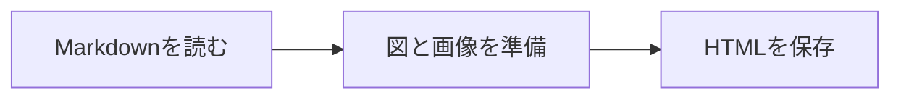
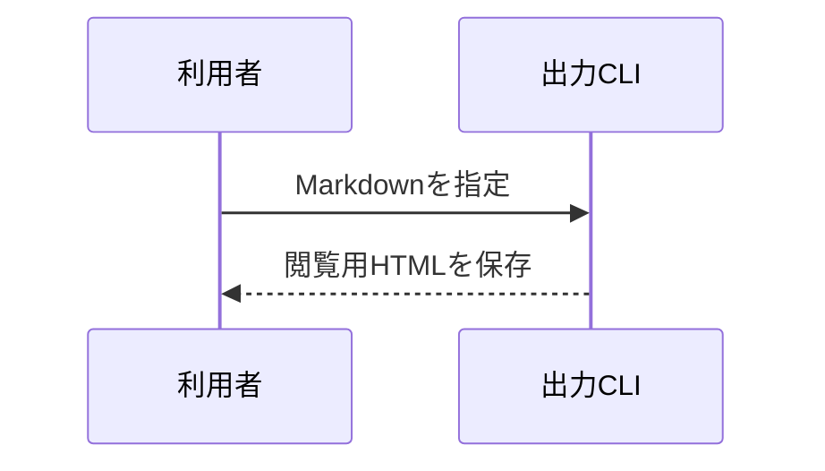
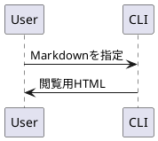

# 単一HTMLの出力サンプル

この文書には、**日本語の本文**、表、コード、図を含めています。
出力したHTMLは、Markdownや画像フォルダーを一緒に配布せずに閲覧できます。

- [x] 本文をHTMLとして保存
- [x] 図をファイル内へ埋め込み
- [x] スクリプトなしモードでは閲覧時のJavaScriptを不要にする

スクリプトありモードでは、右上固定の目次、H2以下の見出しの折りたたみ、図・画像の拡大、コードと表のコピー・折り返しを利用できます。コピーの通知は3秒で消えます。表の見出しの矢印で並べ替え、検索欄で全列から部分一致の絞り込みができます。

## Mermaidの出力形式の比較

### SVGになる例：フローチャート

下の図はSVGです。HTML出力専用の描画設定でHTMLラベルを無効にし、文字もSVGとして描画します。アプリ側の表示設定は変更しません。



### SVGになる例：シーケンス図

下の図はSVGです。このシーケンス図では文字がSVGのtext要素で描かれ、foreignObjectを含まないため、SVGのまま埋め込みます。拡大しても線や文字が鮮明です。



図内の設定指定は引き続き除去します。文書に設定を書かなくても、HTML出力側がSVGラベルを選びます。

判定は図の種類やラベルの見た目ではなく、描画結果にforeignObjectがあるかどうかで行います。Base64は格納方法なので、SVGをBase64で埋め込んでもPNGにはなりません。

### PNGになる例：HTMLを内包するSVG

外部SVGなどにforeignObjectが残る場合は、その図をPNGに変換します。下はHTMLの文章を内包するSVGの例です。

```svg
<svg xmlns="http://www.w3.org/2000/svg" viewBox="0 0 360 100">
  <rect width="360" height="100" fill="#e0f2fe"/>
  <foreignObject x="16" y="16" width="328" height="80"><div xmlns="http://www.w3.org/1999/xhtml" style="font-size:20px;color:#0c4a6e">HTMLラベルを含む図<br/>この図はPNGです</div></foreignObject>
</svg>
```

## 表

```csv
項目,件数,分類
本文,10,テキスト
図,3,画像
コード,5,テキスト
表,2,データ
合計,,
```

## SVGの図

```svg
<svg xmlns="http://www.w3.org/2000/svg" viewBox="0 0 480 110">
  <rect width="480" height="110" rx="14" fill="#e0f2fe"/>
  <circle cx="55" cy="55" r="28" fill="#0284c7"/>
  <text x="105" y="64" font-family="sans-serif" font-size="24" fill="#0c4a6e">SVGも一つのHTMLへ</text>
</svg>
```

## コード

```typescript title="src/export-document.ts"
const document = { title: "単一HTML", standalone: true };
console.log(document.title);
const description = "この長い行は、スクリプトありモードの折り返しボタンで表示を切り替えて確認するためのサンプルです。ウィンドウの幅に合わせて折り返しても、コピーするコードの内容や改行は変わりません。";
```

## PlantUMLの図



> 元の文書は変更せず、閲覧用のHTMLを別のファイルに保存します。
