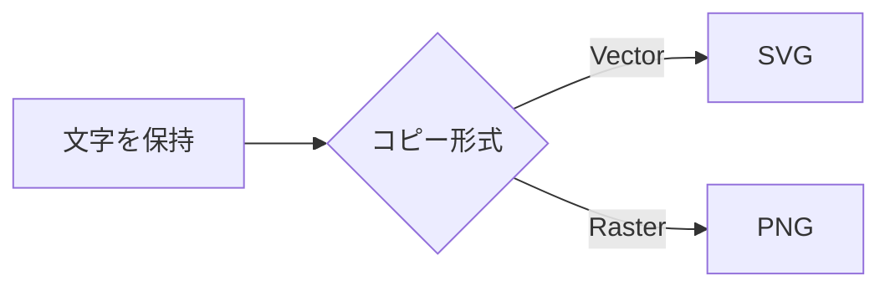

# v0.0.10 編集・図操作テスト

[検証用サンプル目次](sample.md) | [Markdown Editor機能テスト](drawio_markdown_sample.md) | [サンプル集README](README.md)

このファイルは編集モードで開き、v0.0.10のリスト操作、見出し採番、目次並べ替え、図コピーを確認します。

## 1. 構造化リスト

以下の行で`Ctrl+.`、`Ctrl+1`、`Ctrl+[`、`Ctrl+]`を使い、同状態の再入力で解除、別状態の入力で切替できることを確認します。複数行選択でも同様に操作します。

変換対象A
変換対象B

1. 親A
   1. 子A-1
   2. 子A-2
2. 親B
   1. 子B-1

- [ ] 未完了
- [x] 完了済み

確認項目:

- 連番行でEnterすると次番号になり、空項目でEnterするとリストを終了する。
- Tab／Shift+Tabで同じ階層だけが再採番される。
- Alt+↑／Alt+↓で同じインデントの兄弟間を移動し、子項目も一緒に移動する。
- 空の`- `行へ下の2行を貼り付けても`- -`にならない。
- 深い番号行でもEnterで同じインデントの次番号を挿入し、Shift+Enterではインデントを1段増やした番号なし行を挿入する。

混在リストの表示確認:

1. リスト親
  1. リスト子
    1. リスト孫
     - 白丸
       - 黒丸
         - 白丸2
           - 黒丸2
2. リスト親2

貼り付け用:

```text
- 貼り付け一
- 貼り付け二
```

貼り付け先（`-`の末尾に半角スペースを入力して空のリスト項目にしてから貼り付けます）:

-

## 2. 番号付き見出しと目次移動

目次で「子A」「子B」をドラッグし、同階層の挿入バー位置へ本文ごと移動することを確認します。Alt+↑／Alt+↓でも移動できます。「孫A」は階層が異なるため「子B」と入れ替えられません。

### 1. 子A

子Aの本文です。

#### 1. 孫A

孫Aの本文です。子Aを移動すると一緒に移動します。

### 番号なし子

番号なし見出しは自動採番しません。

### 2. 子B

子Bの本文です。並べ替え後、同じ親・同じ見出しレベルの番号付き見出しだけが1から同期します。

## 3. Mermaidコピー

「SVGをコピー」で図形内の「文字を保持」が残り、線上の「Vector」「Raster」が罫線より前面に白い背景付きで表示されることを確認します。SVG／PNGのキャンバス背景は白で、図をクリックしたポップアップの「全体表示」では図が縦横比を保ったままウィンドウの縦または横いっぱいまで拡大・縮小され、不要なスクロール余白がないことも確認します。



## 4. draw.io操作バーと余白

コード／PNG／SVGコピー、プレビュー／コード切替、編集が同じ操作バーに表示されることを確認します。編集保存後も、遠い座標にある図形の実描画領域へプレビューが再フィットして中央に表示され、右端・下端に元ページ由来の余白が残りません。図をクリックするとMermaidと同じポップアップが開き、「全体表示」でウィンドウへ最大フィットします。

```drawio
<mxGraphModel dx="2000" dy="1200" grid="1" gridSize="10" page="1" pageWidth="3000" pageHeight="2000"><root><mxCell id="0"/><mxCell id="1" parent="0"/><mxCell id="2" value="実描画領域" style="rounded=1;whiteSpace=wrap;html=1;" vertex="1" parent="1"><mxGeometry x="1650" y="940" width="160" height="70" as="geometry"/></mxCell><mxCell id="3" value="負座標" style="ellipse;whiteSpace=wrap;html=1;" vertex="1" parent="1"><mxGeometry x="-220" y="-120" width="120" height="70" as="geometry"/></mxCell><mxCell id="4" style="edgeStyle=orthogonalEdgeStyle;rounded=0;html=1;" edge="1" parent="1" source="3" target="2"><mxGeometry relative="1" as="geometry"/></mxCell></root></mxGraphModel>
```

## 5. Base64画像名

[Markdown Editor機能テストのBase64画像](drawio_markdown_sample.md#10-base64画像)を編集し、結果がMarkdownコードへ反映されることを確認します。altが`image.png`でも外部化候補が`image.png.png`にならないことを確認します。
